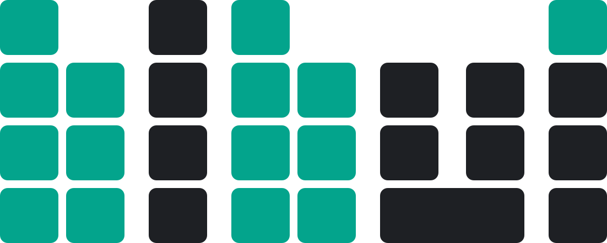
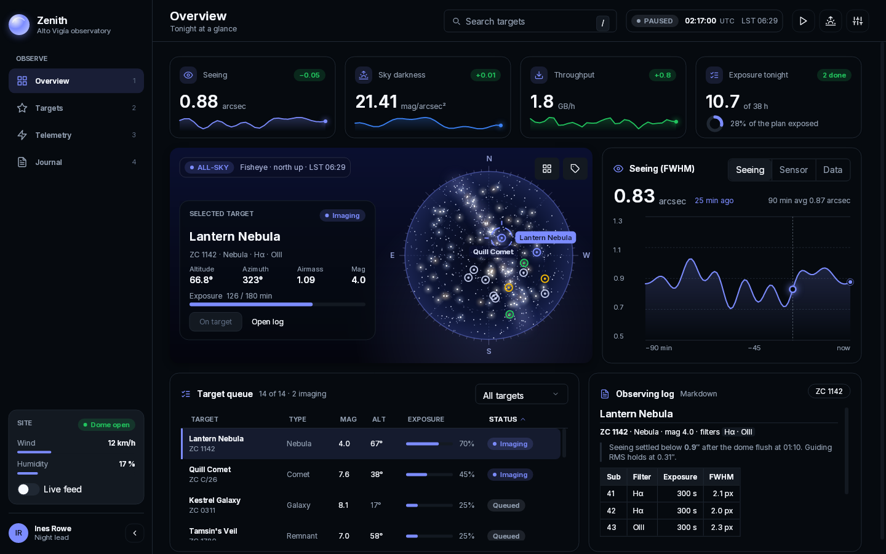
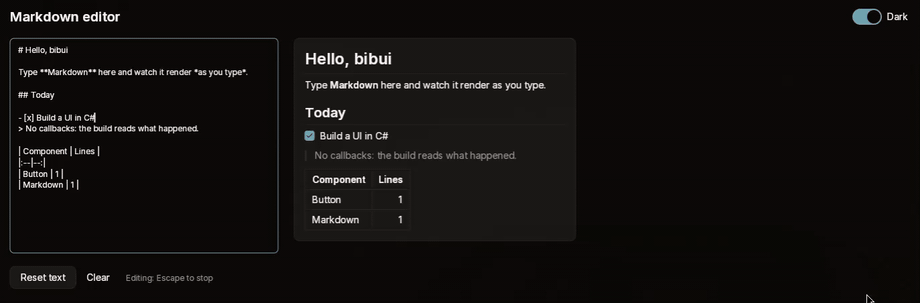

<p align="center">
  <picture>
    <source media="(prefers-color-scheme: dark)" srcset="docs/brand/bibui-logo-on-dark.svg">
    
  </picture>
</p>

<p align="center"><a href="https://navisurgvision.com/bibui"><b>Documentation</b></a></p>

bibui is an immediate-mode UI library for .NET.

The library consists of a few UI node types such as a `Box` and `Text`,
and everything you build is a composition of these simple primitives.

Zenith is a clauded showcase app provided as a reference for inspiration on how you build
applications with bibui.



**Platforms:** Linux on x64, and the browser through .NET WebAssembly. Other
platforms are not supported yet. We expect macOS, and maybe even iOS, to be supported in the near future.

## Install

**Prerequisites**
- .NET 10.

Add the `Bibui` package to a console app:

```bash
dotnet new console -n Counter && cd Counter
dotnet add package Bibui
```

`Bibui` is all of bibui in one reference: the core, `BibuiApp` on a Silk.NET
window drawn by Skia on OpenGL, and every other window, renderer and the
testing package beside it.

## Quick start

With `Bibui` referenced, [`samples/counter`](samples/counter/Program.cs) is a
whole bibui app: a label and a button that counts its clicks.

```csharp
using Bibui.App;
using Bibui.Core.Runtime;

var runtime = BibuiRuntime.Create();
using var app = BibuiApp.Open(runtime, new("Counter", 360, 160));
int count = 0;

while (app.BeginFrame())
{
    runtime.BeginBuild(app.Events);

    runtime.BeginCenterXY();
    var column = runtime.BeginParent(runtime.Column());
    {
        runtime.Text($"Clicked {count} times");
        runtime.Gap(12);
        if (runtime.Button("add", "Add one").Clicked)
            count++;
    }
    runtime.EndParent(column);
    runtime.EndCenterXY();

    runtime.EndBuild();
    app.EndFrame();
}
```

You can run the app using the Skia+OpenGL backend with

```bash
dotnet run --project samples/counter-gl
```


## Minimal dependencies

bibui consists of a core part, [bibui-core](bibui-core), that defines
how you build user interfaces with bibui through layout constraints
and the builtin UI node typestypes.
By itself it has no idea how to talk to the OS to get window and
input events, or do any type of rendering of the UI.

An app package references `bibui-core` and a window and renderer.
By default `Bibui` packages the `Bibui.App.SilkSkiaGl` app package,
but you may reference any of the below builtin app packages instead of
`Bibui`, and get only the dependencies of its window and renderer:

| Package | Window | Renderer | Native AOT |
|---|---|---|---|
| `Bibui.App.SilkSkiaGl` | Silk (GLFW) | Skia on the GPU (OpenGL) | No, JIT only for now |
| `Bibui.App.SilkSkiaCpu` | Silk (GLFW) | Skia on the CPU | No, JIT only for now |
| `Bibui.App.SilkManaged` | Silk (GLFW) | managed rasterizer, on the CPU | No, JIT only for now |
| `Bibui.App.WaylandManaged` | Wayland | managed rasterizer, on the CPU | Yes |
| `Bibui.App.WaylandSkiaCpu` | Wayland | Skia on the CPU | Yes, beside `libSkiaSharp.so` |

```bash
dotnet add package Bibui.App.WaylandManaged   # no third-party NuGet dependencies, and Native AOT
```

An app that publishes with Native AOT references a Wayland app package this
way rather than `Bibui`, whose Silk.NET keeps an app on the JIT.

Every app package has the same `BibuiApp` and the same calls, so changing the
package changes the target and nothing in the code. Reference one at a time:
each defines `BibuiApp`, and `Bibui` already includes `Bibui.App.SilkSkiaGl`.
The `counter-gl`, `counter-cpu` and `counter-wayland` samples compile the same
app, [`samples/counter`](samples/counter/Program.cs), each with a different
package. [App packages](docs/app-packages.md) has the details.

In the browser there is no app package: a browser app references
`Bibui.Platform.Browser` and a renderer, and the browser owns the loop.
[`samples/counter-browser`](samples/counter-browser/Program.cs) is the counter
there, and [bibui in the browser](docs/browser.md) has the details.

## The bibui UI tree structure

bibui has no dedicated `Column` type that contains a list of its children.
Instead every node (`UiNode`, which `Box` and `Text` derive from) links to its
`Parent`, its `FirstChild`/`LastChild` and its siblings `Prev`/`Next`, so any
box holds a subtree.
`Column()` is a fast path for a `Box` that lays its children out on the
y-axis and is sized to fit its children.

In the sample, `runtime.BeginParent(column)` and `runtime.EndParent(column)`
bracket a scope where all boxes built through the runtime are added as
children of `column`.

Each node is built where it goes: the text, then the button, in the order
they appear in the column.

`runtime.Button` is itself a composition: a `Box` that claims left presses,
with a `Text` inside. `button.Clicked` reports an [Interaction](bibui-core/src/Public/Interaction.cs) as a struct with all the interactions the `Box` took.

## bibui app from scratch

A `Bibui.App` package is a fast path for gluing together a window package and a renderer package.

You may instead reference directly `Bibui.Core`, `Bibui.Platform.Silk`,
`Bibui.Raster.Skia`, and then you will have to write the main app loop as:

```csharp
using var window = SilkWindow.Open(runtime, new("Counter", 360, 160));
using var skia = new SkiaGlRenderer(window.Gl);

while (SilkWindow.BeginFrame(window, runtime))  // window:   wait for a frame; Silk input → window.Events
{
    runtime.BeginBuild(window.Events);          // runtime:  WindowEvent → BibUiEvent; start a new tree
    Build();                                    // your app: build boxes and text, read interactions
    runtime.EndBuild();                         // runtime:  lay the tree out, record runtime.DrawList
    SilkWindow.BeginDraw(window);               // renderer: draw the DrawList into the GL framebuffer
    skia.Draw(runtime.DrawList);
    SilkWindow.EndDraw(window);                 // window:   swap; the frame is on screen
    SilkWindow.EndFrame(window, runtime);       // window:   sleep until the next frame is due
}
```

Each layer sends data only to layers below it, and each layer is free to interpret that data however it likes.
With this design, you may target a new platform, by writing a new platform layer that produces `WindowEvent`s.
You may be able to reuse any of the renderers, or write a new one for the platform that renders using the draw operations issued to a `DrawList`.

[Bibui.Platform.Wayland](bibui-platform-wayland/) and the managed rasterizer are both built this way.

This design enables us to have different combinations of platform layers for handling input and renderers, for rendering the bibui `DrawList`.

## Driving an app from outside

`TestPort` (package `Bibui.Automation`) lets a test, a script or an agent drive
a running app over a Unix socket only the user can reach: read the UI tree and
the app's state, send input events and the app's own commands, ask for
screenshots. The app opens it, and calls `TryPullCmd` at the top of each frame
and `AnswerCmds` at its end; a client sends one JSON line per request:

```sh
echo '{"$cmd":"test.tree"}' | socat - UNIX-CONNECT:$XDG_RUNTIME_DIR/bibui/<app>-<pid>.sock
```

`bibui-port` (`tools/bibui-port`, a native command-line tool) does the same in a
word, and clicks a node by id, scrolled into view first:

```sh
bibui-port tree --depth 2
bibui-port click add
bibui-port cmd counter.set Value=10
```

A `BibuiApp` opens none: an app that does not reference `Bibui.Automation` ships
no automation code. [Its README](packaging/readme/Bibui.Automation.md) has the loop, the requests, and a click from a shell.

## Component Library

bibui comes with components built from the same `Box` and `Text` primitives:
buttons, switches, toggles, sliders, text fields, tabs, menus, dialogs, a
Markdown viewer and more. Below, a multiline text field holds Markdown source,
`runtime.Markdown` draws it as it is typed, and a switch changes the theme.



Every component, with pictures, is in [Components](docs/components/index.md).

## Dependencies

bibui uses .NET 10, and the platform + rasterizer route your application uses
decides which other dependencies it needs. In every case the dependency tree is small:

| Package | NuGet dependencies | System libraries |
|---|---|---|
| `Bibui.Core` | `System.IO.Hashing` | `libfreetype6`, `libharfbuzz0b` (text) |
| `Bibui.Raster.Skia` | `SkiaSharp` (with its Linux native assets), `Bibui.Gl` | `libfontconfig1` |
| `Bibui.Gl` | `Silk.NET.OpenGL` (the GL binding only) | an OpenGL driver |
| `Bibui.Platform.Silk` | `Silk.NET` windowing, input and OpenGL (GLFW), `Bibui.Gl`, `TextCopy` | an OpenGL driver; GLFW itself ships with Silk.NET |
| `Bibui.Platform.Wayland` | none | `libwayland-client`, `libwayland-cursor`, `libxkbcommon` |
| `Bibui.Platform.Browser` | none | none: FreeType and HarfBuzz ship inside it, built for the browser; building an app needs the `wasm-tools` workload |
| `Bibui.Raster.Managed.Backend` | none (`Bibui.Raster.Managed`) | none beyond `Bibui.Core`'s |

The Wayland + managed route has no third-party NuGet dependencies at all, and
it is the route that publishes with Native AOT; Silk.NET keeps the others on the
JIT for now.

## Documentation

The documentation is online at
[navisurgvision.com/bibui](https://navisurgvision.com/bibui). In this
repository:

- [Getting started](docs/getting-started.md): from an empty project to a
  component with state, a headless test and a Native AOT binary.
- [Concepts](docs/concepts.md): boxes, layout, asking for interactions,
  retained boxes, painting.
- [Theming](docs/theming.md): built-in themes, theme files and tokens.
- [Components](docs/components/index.md): every component, with pictures.
- [Native AOT](docs/aot.md): publishing one native binary, and the trimming
  rules for app code.
- Samples: [`samples/showcase`](samples/showcase) is an observatory console
  that uses most of bibui, [`samples/bibui-app`](samples/bibui-app) is a short
  interactive app, and [`samples/component-gallery`](samples/component-gallery)
  has a page per component.

## Building from source

```bash
dotnet build bibui-core/bibui-core.csproj -c Release
dotnet run --project tests/bibui-runtime-tests -c Release   # runtime, components and layout tests
dotnet run --project samples/component-gallery              # every component in one window
```

[CONTRIBUTING.md](CONTRIBUTING.md) lists every test project and the rules a
change keeps.

## Licence

bibui is licensed under the Apache License 2.0. See [LICENSE](LICENSE) and
[NOTICE](NOTICE).
