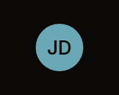
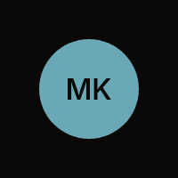

# Avatar

A circle with bold initials centred on it. It takes nothing: it only shows who.

| Default (40 px) | Large (56 px) |
|---|---|
|  |  |

Fixtures: `avatar-default` and `avatar-large`.

## Build

```cs
public static Box Build(
    BibuiRuntime runtime,
    BibuiStr initials,
    float size = DefaultSize,
    UiColor? fill = null,
    UiColor? ink = null,
    ComponentSize fontSize = ComponentSize.Lg)

public const float DefaultSize = 40f;
```

| Parameter | Meaning |
|---|---|
| `initials` | What it reads. One to three characters fit. |
| `size` | The circle's diameter in pixels. |
| `fill`, `ink` | The circle's and the initials' colours, if not the defaults. |
| `fontSize` | The initials' size. |

## Claims and reports

None. It returns a keyless `Box`.

## State the caller owns

None.

## Theme tokens

- Circle: `fill`, or `Accent`.
- Initials: `ink`, or `AccentForeground`, bold.

## Example

```csharp
using Bibui;
using Bibui.Runtime;

sealed class Reviewer
{
    static readonly BibuiStr Initials = BibuiStr.FromStrLit("MK"u8);

    public UiNode Build(BibuiRuntime runtime)
        => Avatar.Build(runtime, Initials, size: 32f, fill: UiColor.SurfaceRaised, ink: UiColor.TextPrimary,
            fontSize: ComponentSize.Sm);
}
```
