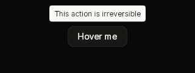

# Button

A labelled button. Solid by default: a raised fill and an edge, with the theme's
hover and press treatments. A ghost button has no fill or edge at rest and only
lights up under the pointer. It is as large as its label plus padding.



*Button has no fixture of its own yet. The picture above is `tooltip-above`,
where a solid button is the tooltip's trigger. `popover-open` and
`menu-dropdown` show it too.*

## Build

```cs
public static BibuiWidget Build(
    BibuiRuntime runtime,
    string id,
    BibuiStr label,
    bool ghost = false,
    bool disabled = false,
    ComponentSize size = ComponentSize.Md)
```

| Parameter | Meaning |
|---|---|
| `id` | The button's retained box. |
| `label` | What it reads. |
| `ghost` | No resting fill or edge, only a hover fill. For toolbars and quiet actions. |
| `disabled` | The label is drawn in the disabled colour. The button swallows the press and reports nothing. |
| `size` | The label's type size. The padding stays the same, so the button grows with its text. |

## Claims and reports

- The box claims `InteractionKinds.LeftPress`, or `InteractionKinds.Disabled`
  when disabled.
- It returns a `BibuiWidget`: act on `Clicked`. `Pressed` and `Hovering` are
  there if you need them.

## State the caller owns

None. A button has no value. What a click means is up to you.

## Theme tokens

- Solid: the fill is `SurfaceRaised`, then `SurfaceRaisedHover` under the pointer
  and `SurfaceRaisedActive` while held. The edge is `Border`, then `BorderHover`,
  then `Accent` while held. These come from `DrawFlags.Border | Background |
  HotEffects | ActiveEffects`.
- Ghost: the hover fill is `SurfaceRaised`.
- The label is `TextColor.Primary`, or `TextColor.Disabled`.
- The edge is `runtime.Theme.Borders.Width` wide. The vertical padding is scaled
  by `runtime.Theme.Density`.

## Example

```csharp
using Bibui;
using Bibui.Runtime;

sealed class Counter
{
    static readonly BibuiStr Minus = BibuiStr.FromStrLit("−"u8);
    static readonly BibuiStr Plus = BibuiStr.FromStrLit("+"u8);
    static readonly BibuiStr Reset = BibuiStr.FromStrLit("Reset"u8);

    int _count;   // the caller's state

    public UiNode Build(BibuiRuntime runtime)
    {
        Box row = runtime.Box();
        row.ChildLayoutAxis = LayoutAxis.X;
        row.SizeX = row.SizeY = SemanticSize.ChildrenSum();
        using (runtime.PushParent(row))
        {
            if (Button.Build(runtime, "counter-minus", Minus).Clicked) _count--;
            runtime.Gap(8f);
            if (Button.Build(runtime, "counter-plus", Plus).Clicked) _count++;
            runtime.Gap(8f);
            // Disabled at zero: still there, and a press on it reaches nothing beneath.
            if (Button.Build(runtime, "counter-reset", Reset, ghost: true, disabled: _count == 0,
                    size: ComponentSize.Sm).Clicked)
                _count = 0;
        }
        return row;
    }
}
```
