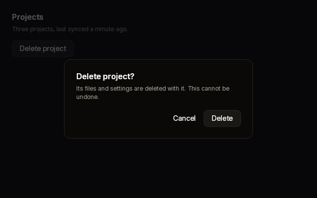
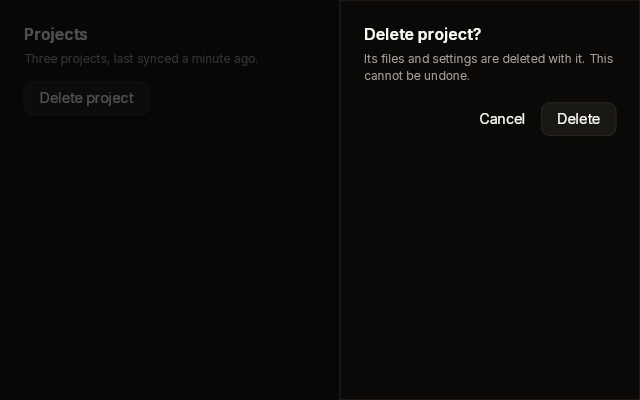

# Dialog

A modal: a scrim over the whole window with a panel on it. The panel can be
centred, or docked to an edge as a sheet (left or right) or a drawer (top or
bottom). You build the panel's content between `Begin` and `End`. The scrim
fades in and the panel slides in as the dialog opens.

| Centred | Sheet from the right |
|---|---|
|  |  |

Fixtures: `dialog-centred` and `dialog-sheet-right`, each fully shown over a
page it dims. The gallery's overlay pages show all four sides.

## Begin and End

```cs
public static DialogScope Begin(
    BibuiRuntime runtime,
    string id,
    float shown,
    DialogSide side = DialogSide.Center,
    float width = 460f)

// DialogScope
public DialogWidget End();

public enum DialogSide { Center, Left, Right, Top, Bottom }
public readonly record struct DialogWidget(Box Panel, bool Dismissed);
```

| Parameter | Meaning |
|---|---|
| `id` | The dialog's dropdown root. The panel is the retained box `{id}-panel`. |
| `shown` | How far open it is, eased from 0 to 1. It fades the scrim and the panel and slides the panel. |
| `side` | `Center` is `width` wide and as tall as its content. `Left` and `Right` are `width` wide and the window's height. `Top` and `Bottom` are the window's width and as tall as their content. |
| `width` | The panel's width, for `Center`, `Left` and `Right`. |

Get `shown` from `runtime.Animate(id, "open", open ? 1f : 0f)`. Ask for it every
frame, open or not, so that closing animates too. Build the dialog only while
`shown` is above 0.

## Claims and reports

- The dialog is one of the runtime's dropdown roots. It is drawn over everything,
  and while it is up nothing beneath it gets a press or a hover.
- `End()` asks about the panel (claiming `InteractionKinds.Press`) after its
  content, so a press on the panel's padding stops there. Then it asks about the
  scrim (claiming `LeftPress`).
- `Dismissed` means a press landed on the scrim outside the panel. Close the
  dialog on it, or ignore it for a dialog that needs an answer.

## State the caller owns

Whether it is open. The eased `shown` lives in `runtime.Animate`.

## Theme tokens

- Panel: a `Surface` fill, a `Border` edge `runtime.Theme.Borders.Width` wide, and
  the `runtime.Theme.Elevation` modal shadow.
- Scrim: a fixed near-black at 70%, not a token yet.

## Example

```csharp
using Bibui;
using Bibui.Runtime;

sealed class DeleteConfirmation
{
    const string Delete = "Delete…";
    const string Cancel = "Cancel";
    const string Confirm = "Delete";
    const string Question = "Delete this case? This cannot be undone.";

    bool _open;   // the caller's state

    public UiNode Build(BibuiRuntime runtime)
    {
        var trigger = runtime.Button("delete-open", Delete);
        if (trigger.Clicked) _open = true;

        float shown = runtime.Animate("delete-dialog", "open", _open ? 1f : 0f);
        if (shown > 0f)
        {
            var dialog = Dialog.Begin(runtime, "delete-dialog", shown, width: 400f);
            runtime.Text(Question);
            runtime.Gap(24f);
            bool close = runtime.Button("delete-cancel", Cancel, ghost: true).Clicked;
            runtime.Gap(8f);
            close |= runtime.Button("delete-confirm", Confirm).Clicked;
            if (dialog.End().Dismissed || close) _open = false;
        }
        return trigger;
    }
}
```
