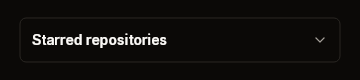
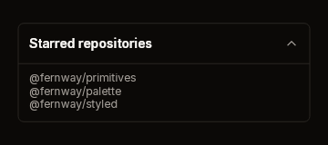

# Expander

An outlined frame with a header (a bold title and a chevron) that takes the
press. While it is open, a rule and a body follow the header, and you build the
content into the body. An accordion is several expanders, with the caller
keeping track of which one is open.

| Closed | Open |
|---|---|
|  |  |

Fixtures: `expander-closed` and `expander-open`.

## Build

```cs
public static ExpanderWidget Expander(
    this BibuiRuntime runtime,
    string id,
    ReadOnlySpan<char> title,
    bool open)

public readonly record struct ExpanderWidget(Box Node, Box? Body, Interaction Interaction)
{
    public bool Toggled { get; }   // the header was clicked
}

public const float HeaderHeight = 44f;
```

| Parameter | Meaning |
|---|---|
| `id` | The header's retained box. |
| `title` | The header's bold title. |
| `open` | Whether to show the body. |

The frame is as wide as its parent. While open, `Body` is a padded column as
wide as the frame and as tall as what you build into it. While closed, `Body` is
null.

## Claims and reports

- The header claims `InteractionKinds.LeftPress`.
- It returns an `ExpanderWidget`. `Toggled` means the header was clicked this
  frame. `Interaction` has the rest.

## State the caller owns

Whether it is `open`.

## Theme tokens

- Frame and rule: `Border`, `runtime.Theme.Borders.Width` wide.
- Title: `TextColor.Primary`, bold. Chevron: `TextSecondary`.
- Header height: 44 px, scaled by `runtime.Theme.Density`.

## Example

```csharp
using Bibui;
using Bibui.Runtime;

sealed class StarredRepositories
{
    const string Title = "Starred repositories";
    static readonly string[] Lines = ["@fernway/primitives", "@fernway/palette"];

    bool _open;   // the caller's state

    public UiNode Build(BibuiRuntime runtime)
    {
        Box column = runtime.Box();
        column.ChildLayoutAxis = LayoutAxis.Y;
        column.SizeX = SemanticSize.Pixels(320f);
        column.SizeY = SemanticSize.ChildrenSum();
        using (runtime.PushParent(column))
        {
            var section = runtime.Expander("starred", Title, _open);
            if (section.Toggled) _open = !_open;
            if (section.Body is { } body)
                using (runtime.PushParent(body))
                    foreach (var line in Lines)
                        runtime.Text(line, ComponentSize.Sm, TextColor.Secondary);
        }
        return column;
    }
}
```
