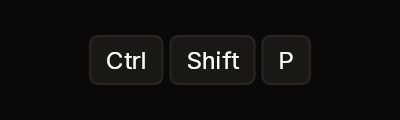
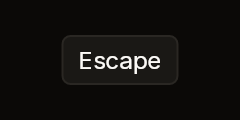

# KeyboardShortcut

A keyboard shortcut: a row of keycaps, each a small raised box with a border
around one key's name. It takes nothing.

| Chord | Single key |
|---|---|
|  |  |

Fixtures: `keyboard-shortcut-chord` and `keyboard-shortcut-single`.

## Build

```cs
public static Box Build(BibuiRuntime runtime, params ReadOnlySpan<BibuiStr> keys)

public const float KeyHeight = 24f;
```

| Parameter | Meaning |
|---|---|
| `keys` | One keycap per key, in order, 4 px apart. |

The row is as wide as its keycaps and 24 px tall.

## Claims and reports

None. It returns a keyless `Box`.

## State the caller owns

None.

## Theme tokens

- Keycap: a `SurfaceRaised` fill and a `Border` edge `runtime.Theme.Borders.Width`
  wide.
- Key name: `TextColor.Primary`, at the small size.

## Example

```csharp
using Bibui;
using Bibui.Runtime;

sealed class CommandPaletteHint
{
    static readonly BibuiStr Ctrl = BibuiStr.FromStrLit("Ctrl"u8);
    static readonly BibuiStr Shift = BibuiStr.FromStrLit("Shift"u8);
    static readonly BibuiStr P = BibuiStr.FromStrLit("P"u8);

    public UiNode Build(BibuiRuntime runtime) => KeyboardShortcut.Build(runtime, Ctrl, Shift, P);
}
```
