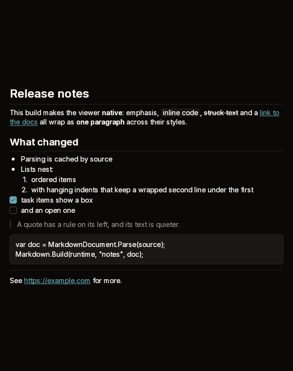
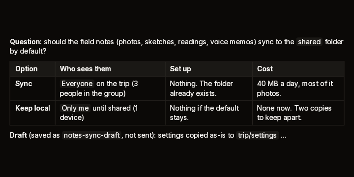
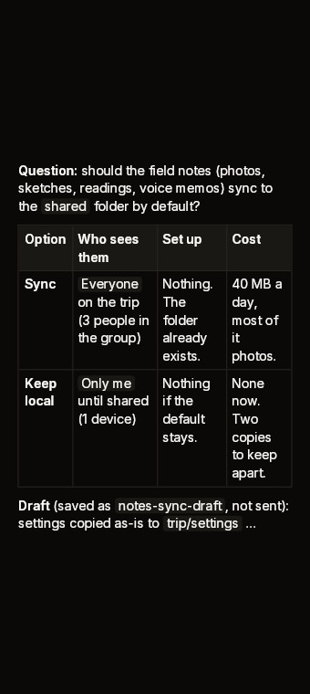

# Markdown

A read-only Markdown viewer built from boxes and texts. It supports CommonMark
blocks and inlines, with GFM tables, task items, strikethrough and bare-URL
autolinks. A paragraph wraps as one paragraph across its styles: a bold word, a
code span and plain text break together. Links and task boxes take the press and
report it. The viewer never changes the source.



| A table | The same table, narrow |
|---|---|
|  |  |

Fixtures: `markdown-basic`, `markdown-table` and `markdown-narrow`.

## Build

```cs
public static MarkdownWidget Markdown(
    this BibuiRuntime runtime,
    string id,
    BibuiStr source,
    float? width = null,
    ComponentSize textSize = ComponentSize.Md)

public static MarkdownWidget Markdown(
    this BibuiRuntime runtime,
    string id,
    MarkdownDocument document,
    float? width = null,
    ComponentSize textSize = ComponentSize.Md)

public static void ToggleTask(BibuiStr source, int offset);

public readonly record struct MarkdownWidget(Box Node, string? ClickedLink, int ToggledTask)
{
    public bool LinkClicked { get; }
    public bool TaskClicked { get; }
}
```

| Parameter | Meaning |
|---|---|
| `id` | The viewer's retained root. Its links, task boxes and wide tables are retained boxes under it. |
| `source` | The Markdown, in a buffer you own. It is parsed once and cached per runtime and id until the text changes, so a frame costs one comparison and the build. |
| `document` | A document you parsed with `MarkdownDocument.Parse` and keep yourself. This skips the comparison. |
| `width` | The viewer's width. With null, it is as wide as its parent, which must then have a width of its own. It is as tall as the document. |
| `textSize` | Body text size. Headings use the steps above it. |

Italics are set in the body face, because the type system has no oblique face
yet.

## Claims and reports

- Each link and each task box claims `InteractionKinds.LeftPress`. A table wider
  than the viewer scrolls sideways (`ViewScrollX | ClampX | Clip`).
- It returns a `MarkdownWidget`. `ClickedLink` is the destination of a link
  clicked this frame. `ToggledTask` is the source offset of a task box clicked
  this frame, or -1.

## State the caller owns

The source. To tick a task, pass `ToggledTask` to
`Markdown.ToggleTask(source, offset)`, which edits your `BibuiStr` in place. To
open a link, act on `ClickedLink` yourself.

## Theme tokens

- Links: `Accent`. Code spans, code blocks and table headers: `SurfaceRaised`.
- Task boxes: an `Accent` fill and edge when ticked, with an `AccentForeground`
  check and an `AccentHover` hover edge. Otherwise a `Surface` fill, a
  `BorderHover` edge and a `BorderFocus` hover edge.
- Rules, quote bars and table lines: `Border`, `runtime.Theme.Borders.Width`
  wide, and `Borders.Strong` where heavier.
- Body text `TextPrimary`, quieter text (quotes) `TextSecondary`. Spacing is
  scaled by `runtime.Theme.Density`.

## Example

```csharp
using Bibui.Core;
using Bibui.Core.Runtime;

sealed class ReleaseNotes
{
    // The caller's state: the source, which a ticked task rewrites.
    readonly BibuiStr _source = BibuiStr.FromStrLit("""
        ## Before release

        - [x] Tag the build
        - [ ] Publish the [notes](https://example.com/notes)
        """);

    public string? OpenedLink { get; private set; }

    public UiNode Build(BibuiRuntime runtime)
    {
        var notes = runtime.Markdown("release-notes", _source, width: 480f);
        if (notes.TaskClicked) Markdown.ToggleTask(_source, notes.ToggledTask);
        if (notes.LinkClicked) OpenedLink = notes.ClickedLink;
        return notes;
    }
}
```
