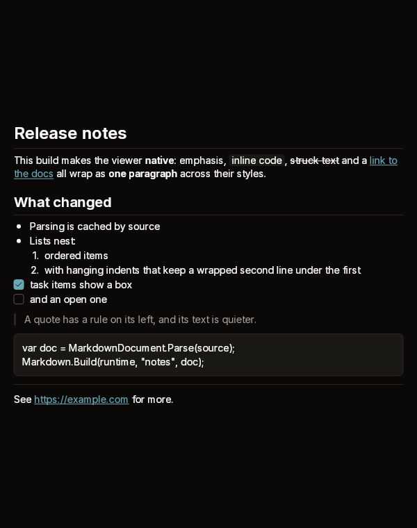
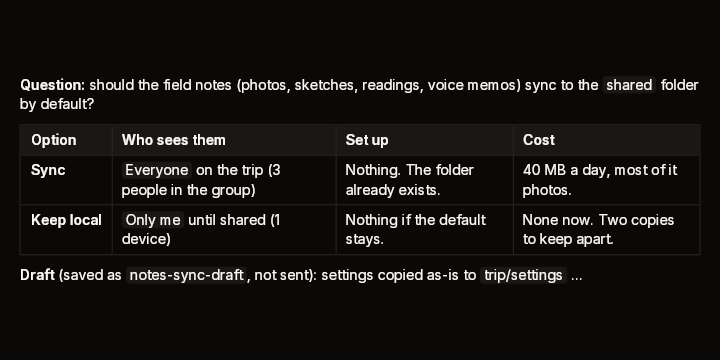
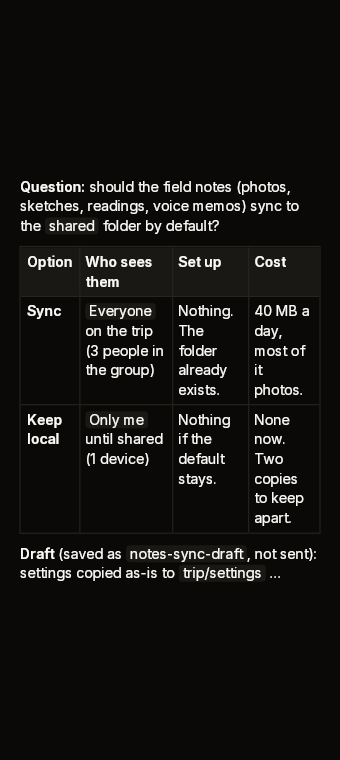

# Markdown

A read-only Markdown viewer built from boxes and texts. It supports CommonMark
blocks and inlines, with GFM tables, task items, strikethrough and bare-URL
autolinks. A paragraph wraps as one paragraph across its styles: a bold word, a
code span and plain text break together. Links and task boxes take the press and
report it. The viewer never changes the source.



| A table | The same table, narrow |
|---|---|
|  |  |

Fixtures: `markdown-basic`, `markdown-table` and `markdown-narrow`.

## Build

```cs
public static MarkdownWidget Markdown(
    this BibuiRuntime runtime,
    string id,
    BibuiStr source,
    float? width = null,
    ComponentSize textSize = ComponentSize.Md,
    MarkdownBlockDraw? drawBlock = null)

public static MarkdownWidget Markdown(
    this BibuiRuntime runtime,
    string id,
    MarkdownDocument document,
    float? width = null,
    ComponentSize textSize = ComponentSize.Md,
    MarkdownBlockDraw? drawBlock = null)

public static void ToggleTask(BibuiStr source, int offset);

public delegate bool MarkdownBlockDraw(
    BibuiRuntime runtime, MarkdownDocument document, MarkdownBlock block, float width);

public readonly record struct MarkdownWidget(Box Node, string? ClickedLink, int ToggledTask)
{
    public bool LinkClicked { get; }
    public bool TaskClicked { get; }
}
```

| Parameter | Meaning |
|---|---|
| `id` | The viewer's retained root. Its links, task boxes and wide tables are retained boxes under it. |
| `source` | The Markdown, in a buffer you own. It is parsed once and cached per runtime and id until the text changes, so a frame costs one comparison and the build. |
| `document` | A document you parsed with `MarkdownDocument.Parse` and keep yourself. This skips the comparison. |
| `width` | The viewer's width. With null, it is as wide as its parent, which must then have a width of its own. It is as tall as the document. |
| `textSize` | Body text size. Headings use the steps above it. |
| `drawBlock` | Draws the blocks the app draws its own way. With null, the viewer draws every block. See [Blocks the app draws](#blocks-the-app-draws). |

Emphasis is set in the italic, strong emphasis in the semibold, and the two
together in the semibold italic (`FontWeight.Italic`, `Bold` and
`BoldItalic`): Inter's, or the theme's body family's when it registers them
(`FontRegistry`). Code inside emphasis is set in the mono family's italic,
which, with no mono family, is Inter Italic.

## Source spans

Every `MarkdownBlock` says which lines of the source it came from, in
`SourceStart` and `SourceEnd`: char offsets into the text you parsed, the end
exclusive.

- A block's span is whole lines, from the first char of its first line to the
  last char of its last, before the line break. It includes the indent and the
  markers: the `#`s of a heading, a fence, a setext underline, a `>`, a list
  marker, a table's delimiter row.
- A nested block shares its lines with its containers' markers: the paragraph
  in `> text` spans the whole line.
- Blank lines after a block are not its own, and nor are lines that are only
  link reference definitions. A paragraph that opens with a definition spans it.
- The text between two top-level blocks is blank lines and definitions.
- An unclosed fence ends at its last line that is not blank, though the code
  block it draws keeps the blank lines after it.
- A quote or list item keeps the lines its markers are on, even when they
  hold only link reference definitions.
- The document spans the whole source, from 0.

## Blocks the app draws

Some blocks an app shows its own way: an image alone on its line, a diagram
from a fenced code block in a language it reads. Pass `drawBlock`, and the
viewer asks it for each block before drawing the block itself:

- It builds the block under the parent in scope, `width` wide, the room the
  viewer has there, and answers true. The viewer leaves the space above and
  below the block it would leave for the block it stands for.
- It answers false, having built nothing, for a block it leaves to the viewer.
  That is every block, the first frame an image is still loading, or a diagram
  it cannot read, which then stays code.
- It is asked for every block, those in quotes and list items too, each frame
  the viewer draws it, so it should decide cheaply: keep what it works out per
  block until the document changes, which is a new `MarkdownDocument`.
- Pass a delegate you keep, such as a static method or one you made once, so a
  frame allocates nothing.

```cs
static bool Diagrams(BibuiRuntime runtime, MarkdownDocument document, MarkdownBlock block, float width)
{
    if (block.Kind != MarkdownBlockKind.CodeBlock || block.Info != "dot") return false;
    MyDiagram.Draw(runtime, document.CodeOf(block).Span, width);
    return true;
}

runtime.Markdown("notes", source, drawBlock: Diagrams);
```

`MarkdownEditor` takes the same drawer, and a press on such a block edits its
source.

## Claims and reports

- Each link and each task box claims `InteractionKinds.LeftPress`. A table wider
  than the viewer scrolls sideways (`ViewScrollX | ClampX | Clip`).
- It returns a `MarkdownWidget`. `ClickedLink` is the destination of a link
  clicked this frame. `ToggledTask` is the source offset of a task box clicked
  this frame, or -1.

## State the caller owns

The source. To tick a task, pass `ToggledTask` to
`Markdown.ToggleTask(source, offset)`, which edits your `BibuiStr` in place. To
open a link, act on `ClickedLink` yourself.

## Theme tokens

- Links: `Accent`. Code spans, code blocks and table headers: `SurfaceRaised`.
- Task boxes: an `Accent` fill and edge when ticked, with an `AccentForeground`
  check and an `AccentHover` hover edge. Otherwise a `Surface` fill, a
  `BorderHover` edge and a `BorderFocus` hover edge.
- Rules, quote bars and table lines: `Border`, `runtime.Theme.Borders.Width`
  wide, and `Borders.Strong` where heavier.
- Body text `TextPrimary`, quieter text (quotes) `TextSecondary`. Spacing is
  scaled by `runtime.Theme.Density`.

## Example

```csharp
using Bibui.Core;
using Bibui.Core.Runtime;

sealed class ReleaseNotes
{
    // The caller's state: the source, which a ticked task rewrites.
    readonly BibuiStr _source = BibuiStr.FromStrLit("""
        ## Before release

        - [x] Tag the build
        - [ ] Publish the [notes](https://example.com/notes)
        """);

    public string? OpenedLink { get; private set; }

    public UiNode Build(BibuiRuntime runtime)
    {
        var notes = runtime.Markdown("release-notes", _source, width: 480f);
        if (notes.TaskClicked) Markdown.ToggleTask(_source, notes.ToggledTask);
        if (notes.LinkClicked) OpenedLink = notes.ClickedLink;
        return notes;
    }
}
```
