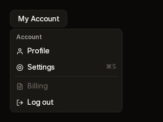
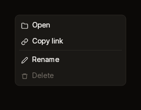

# Menu

A raised list of actions. It serves as a dropdown menu, opened under a trigger,
and as a context menu, opened where the right button went down. You build rows
between `Begin` and `End` from `Item`, `Separator` and `Label`, or from rows of
your own.

| Dropdown | Context |
|---|---|
|  |  |

Fixtures: `menu-dropdown` and `menu-context`.

## Begin, rows, End

```cs
public static MenuScope? Begin(BibuiRuntime runtime, string id, float x, float y, float width = 220f)
public static MenuScope? BeginBelow(BibuiRuntime runtime, string id, UiNode anchor, float width = 220f, float gap = 4f)

public static BibuiWidget MenuItem(
    this BibuiRuntime runtime,
    string id,
    ReadOnlySpan<char> label,
    string? icon = null,
    ReadOnlySpan<char> shortcut = default,
    bool disabled = false)
public static Box Separator(BibuiRuntime runtime)
public static Box Label(BibuiRuntime runtime, ReadOnlySpan<char> text)

// MenuScope
public BibuiWidget End();
```

`Begin` and `BeginBelow` return null while the menu is not open. It opens with
`runtime.OpenDropDown(id, anchor)` and closes with `runtime.CloseDropDown(id)`.

| Parameter | Meaning |
|---|---|
| `id` (Begin) | The menu's dropdown. |
| `x`, `y` | Where its top left goes, in window coordinates: for a context menu, the pointer's position at the right press. |
| `anchor` | `BeginBelow` opens under this box where it was drawn last frame, with the left edges aligned. |
| `width` | The menu's width. It is as tall as its rows. |
| `id` (Item) | The row's retained box. |
| `icon` | The name of an icon before the label. |
| `shortcut` | Quiet text at the row's far end, such as `⌘S`. |
| `disabled` | A quiet row with no hover. It swallows the press. |

## Claims and reports

- Each `Item` claims `InteractionKinds.LeftPress`, or `Disabled`, and returns its
  own `BibuiWidget`: act on `Clicked`.
- The menu is one of the runtime's dropdowns. It is drawn over everything, and
  nothing beneath it gets a press where it was drawn. `End()` claims
  `InteractionKinds.Press` for the list after its rows, so a press on its padding
  or on a rule stops there.
- `End()` returns the list and its own `Interaction`. It eats an Escape no one
  has eaten and closes the menu, so the Escape does not also close what is
  under it. Something built before the menu that reads keys has Escape first:
  leave it alone while the menu is open.
- `Separator` and `Label` take nothing.
- A press closes the open menu when a box outside the menu and its anchor takes
  it, or when nothing takes it. The press still reaches the box that took it.
  A trigger opened it with itself as the anchor, so its own press leaves the
  menu to it: its click closes the menu. A context menu opened on a right press
  is opened again by the next one, wherever it lands, and so moves there.

## State the caller owns

For a context menu, where it opens. The runtime keeps whether it is open. An
item clicked is usually your cue to act and close the menu.

## Theme tokens

- List: a `SurfaceRaised` fill, a `Border` edge `runtime.Theme.Borders.Width`
  wide, and the `runtime.Theme.Elevation` overlay shadow.
- Item: `TextPrimary` label and icon (`TextDisabled` when disabled), a
  `SurfaceRaisedHover` hover fill, and a `TextDisabled` shortcut. Vertical
  padding is scaled by `runtime.Theme.Density`.
- Separator: `Border`. Label: `TextSecondary`, bold, at the small size.

## Example

```csharp
using Bibui;
using Bibui.Runtime;

sealed class AccountMenu
{
    const string Trigger = "My Account";
    const string Account = "Account";
    const string Profile = "Profile";
    const string Settings = "Settings";
    const string SettingsKey = "⌘S";
    const string LogOut = "Log out";

    public UiNode Build(BibuiRuntime runtime)
    {
        var trigger = runtime.Button("account-trigger", Trigger);
        if (trigger.Clicked)
            if (runtime.IsDropDownOpen("account-menu")) runtime.CloseDropDown("account-menu");
            else runtime.OpenDropDown("account-menu", trigger.Node);

        if (Menu.BeginBelow(runtime, "account-menu", trigger.Node) is { } menu)
        {
            Menu.Label(runtime, Account);
            bool chosen = runtime.MenuItem("account-profile", Profile, "user").Clicked;
            chosen |= runtime.MenuItem("account-settings", Settings, "settings", SettingsKey).Clicked;
            Menu.Separator(runtime);
            chosen |= runtime.MenuItem("account-logout", LogOut, "log-out").Clicked;
            menu.End();
            if (chosen) runtime.CloseDropDown("account-menu");
        }
        return trigger;
    }
}
```

For a context menu, ask about the area that opens it, and open the menu at the
pointer on its right press:

```csharp
using Bibui;
using Bibui.Runtime;

sealed class FileContextMenu
{
    const string Rename = "Rename";
    const string Delete = "Delete";

    (float X, float Y) _at;   // the caller's state: where it opens

    public UiNode Build(BibuiRuntime runtime)
    {
        Box area = runtime.BoxFromId("file-area", InteractionKinds.RightPress);
        var press = runtime.InteractionsFor(area);
        // The area's press closed an open menu; opening it again here moves it.
        if (press.RightPressed) { _at = (press.X, press.Y); runtime.OpenDropDown("file-menu"); }
        area.SizeX = SemanticSize.Pixels(320f);
        area.SizeY = SemanticSize.Pixels(200f);

        if (Menu.Begin(runtime, "file-menu", _at.X, _at.Y) is { } menu)
        {
            bool chosen = runtime.MenuItem("file-rename", Rename, "pencil").Clicked;
            chosen |= runtime.MenuItem("file-delete", Delete, "trash").Clicked;
            menu.End();
            if (chosen) runtime.CloseDropDown("file-menu");
        }
        return area;
    }
}
```
