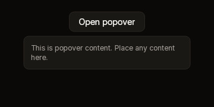

# Popover

A raised panel centred under a box you hold, with whatever you build between
`Begin` and `End` inside it. It has no trigger of its own: build one, a button
or anything else you can ask about.



Fixture: `popover-open`.

## Begin and End

```cs
public static PopoverScope? Begin(BibuiRuntime runtime, string id, UiNode anchor, float width = 280f)

// PopoverScope
public BibuiWidget End();
```

`Begin` returns null while the popover is not open. Your trigger opens it with
`runtime.OpenDropDown(id, trigger)` and closes it with `runtime.CloseDropDown(id)`.

| Parameter | Meaning |
|---|---|
| `id` | The popover's dropdown. |
| `anchor` | The node it opens under, 8 px below and centred on it, where it was drawn last frame. |
| `width` | The panel's width. It is as tall as its content. |

## Claims and reports

- The popover is one of the runtime's dropdowns. It is drawn over everything,
  and nothing beneath it gets a press where it was drawn.
- `End()` claims `InteractionKinds.Press` for the panel after its content, and
  returns its `BibuiWidget`. Use `Hovering` to keep a hover card open while the
  pointer is on it.
- A press closes it when a box outside the popover and its trigger takes it, or
  when nothing takes it.

## State the caller owns

None: the runtime keeps whether it is open. A hover card opens it while the
pointer is over the trigger or the card, and closes it when it is over neither.

## Theme tokens

- Panel: a `SurfaceRaised` fill, a `Border` edge `runtime.Theme.Borders.Width`
  wide, and the `runtime.Theme.Elevation` overlay shadow.

## Example

```csharp
using Bibui;
using Bibui.Runtime;

sealed class SharePopover
{
    const string Share = "Share";
    const string Body = "Anyone with the link can view.";

    public UiNode Build(BibuiRuntime runtime)
    {
        var trigger = runtime.Button("share", Share);
        if (trigger.Clicked)
            if (runtime.IsDropDownOpen("share-popover")) runtime.CloseDropDown("share-popover");
            else runtime.OpenDropDown("share-popover", trigger.Node);

        if (Popover.Begin(runtime, "share-popover", trigger.Node) is { } popover)
        {
            runtime.Text(Body, ComponentSize.Sm, TextColor.Secondary);
            popover.End();
        }
        return trigger;
    }
}
```
