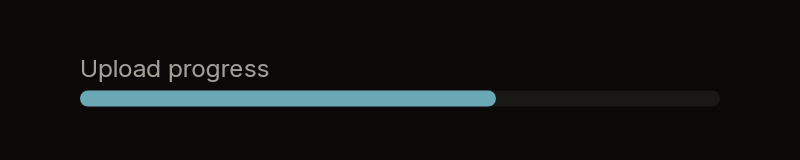
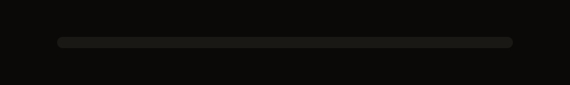
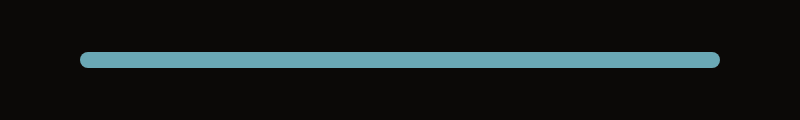

# Progress

A progress bar: a pill-shaped track holding a filled pill as long as the share
done, with an optional label above. It takes nothing.

| Labelled, 65% | Empty | Full |
|---|---|---|
|  |  |  |

Fixtures: `progress-labelled`, `progress-empty` and `progress-full`.

## Build

```cs
public static Box Build(
    BibuiRuntime runtime,
    float value,
    float max = 100f,
    BibuiStr? label = null,
    float thickness = DefaultThickness,
    UiColor? fill = null,
    UiColor? track = null)

public const float DefaultThickness = 8f;
```

| Parameter | Meaning |
|---|---|
| `value`, `max` | The share done is `value / max`, clamped to 0..1. |
| `label` | A small secondary caption above the track. |
| `thickness` | The track's height in pixels. |
| `fill`, `track` | The filled part's and the track's colours, if not the defaults. |

It is as wide as its parent unless you size the node it returns: the column with
the label, or the track alone.

## Claims and reports

None. It returns a keyless `Box`.

## State the caller owns

The `value`.

## Theme tokens

- Track: `track`, or `SurfaceRaised`. Fill: `fill`, or `Accent`.
- Label: `TextColor.Secondary`, at the small size.

## Example

```csharp
using Bibui;
using Bibui.Runtime;

sealed class UploadProgress
{
    static readonly BibuiStr Label = BibuiStr.FromStrLit("Upload progress"u8);

    public long Sent { get; set; }          // the caller's state, shown
    public long Total { get; set; } = 1;

    public UiNode Build(BibuiRuntime runtime)
    {
        Box bar = Progress.Build(runtime, Sent, Total, Label);
        bar.SizeX = SemanticSize.Pixels(320f);
        return bar;
    }
}
```
