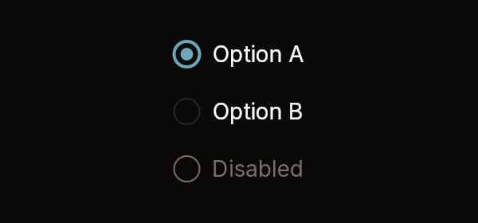
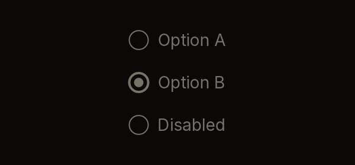

# RadioGroup

A column of options, each a 16 px ring and a label. The chosen option has a dot
in its ring. Each row takes its own press, so the label is as much a target as
the ring.

| Default | Disabled |
|---|---|
|  |  |

Fixtures: `radio-group-default` and `radio-group-disabled`.

## Build

```cs
public static RadioGroupWidget RadioGroup(
    this BibuiRuntime runtime,
    string id,
    IReadOnlyList<RadioOption> items,
    string? value,
    bool disabled = false)

public readonly record struct RadioOption(string Label, string Value, bool Disabled = false);
public readonly record struct RadioGroupWidget(Box Node, string? Picked);
```

| Parameter | Meaning |
|---|---|
| `id` | Names the rows: `{id}-{value}`. |
| `items` | The options in order. An option with `Disabled` swallows its press. |
| `value` | The chosen option's value, or null for none. |
| `disabled` | Disables every option. |

## Claims and reports

- Each row claims `InteractionKinds.LeftPress`, or `Disabled` when that option
  or the whole group is disabled.
- It returns a `RadioGroupWidget`. `Picked` is the value of the option clicked
  this frame, or null. Clicking the option that is already chosen reports
  nothing.

## State the caller owns

The chosen `value`.

## Theme tokens

- Ring edge: `Accent` when chosen, otherwise `Border`, and `TextDisabled` when
  disabled. It is `runtime.Theme.Borders.Strong` wide when chosen, otherwise
  `Borders.Width`.
- Dot: `Accent`, or `TextDisabled`.
- Label: `TextColor.Primary`, or `TextColor.Disabled`.
- Row height: 32 px, scaled by `runtime.Theme.Density`.

## Example

```csharp
using Bibui.Core;
using Bibui.Core.Runtime;

sealed class ShippingChoice
{
    static readonly RadioOption[] Options =
    [
        new("Standard", "standard"),
        new("Express", "express"),
        new("Same day (sold out)", "same-day", Disabled: true),
    ];

    string _shipping = "standard";   // the caller's state

    public UiNode Build(BibuiRuntime runtime)
    {
        var group = runtime.RadioGroup("shipping", Options, _shipping);
        if (group.Picked is { } picked) _shipping = picked;
        return group.Node;
    }
}
```
