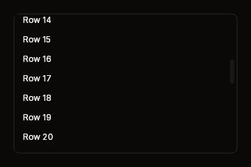

# Scrollbar

A bar for a box that scrolls. It sits beside the view, not over it. A track holds
the space before the thumb, the thumb, and the space after it. Each is a share
of the track, taken from the view as it was last frame. Drag the thumb to put
its centre under the pointer. Press either space to page by one view.



Fixture: `scrollbar-scrolled`, a view of 40 rows scrolled 364 px down, its thumb
about two fifths of the way along the track. The gallery's Scrollbar page shows
both axes.

## Build

```cs
public static BibuiWidget Build(BibuiRuntime runtime, string id, Box view, LayoutAxis axis = LayoutAxis.Y)

public const float Lane = 12f;   // the width of the bar's lane, which catches its presses
```

| Parameter | Meaning |
|---|---|
| `id` | The track's retained box. The parts are `{id}-before`, `{id}-thumb` and `{id}-after`. |
| `view` | The box that scrolls. It reads `Extent`, `ContentSize` and `ViewOffset`, and writes `TargetViewOffset`. |
| `axis` | `LayoutAxis.Y` for a vertical bar, `LayoutAxis.X` for a horizontal one. |

The track is a 12 px lane across the axis and as long as its parent along it. It
keeps its lane when there is nothing to scroll, so the view does not change size
as its content crosses the edge.

Acquire the view and the bar under one parent laid out across the bar's axis: a
row for a vertical bar, a column for a horizontal one. The view should claim the
wheel and the clamp on the same axis (`ViewScrollY | ClampY`), because the bar
moves the view's target and leaves keeping it in range to the clamp.

## Claims and reports

- The thumb and both spaces claim `InteractionKinds.LeftPress`. The track claims
  nothing.
- It returns a `BibuiWidget` whose `Node` is the track, with the thumb's
  `Interaction`. Its `Dragging` is true while the thumb is held. When there is
  nothing to scroll, it reports nothing.

## State the caller owns

None. The scroll position lives on the view, a retained box.

## Theme tokens

- Thumb: `SurfaceRaised`, then `SurfaceRaisedHover` under the pointer and
  `SurfaceRaisedActive` while held, from `DrawFlags.Background | HotEffects |
  ActiveEffects`. The track draws nothing.

## Example

```csharp
using Bibui;
using Bibui.Runtime;

sealed class LogView
{
    static readonly string[] Lines = [.. Enumerable.Range(1, 40).Select(i => $"Line {i}")];

    public UiNode Build(BibuiRuntime runtime)
    {
        // A row: the view, then the bar's lane beside it.
        Box panel = runtime.BoxFromId("log-panel");
        panel.ChildLayoutAxis = LayoutAxis.X;
        panel.SizeX = SemanticSize.Pixels(320f);
        panel.SizeY = SemanticSize.Pixels(200f);

        Box view = runtime.BoxFromId("log-view",
            InteractionKinds.ViewScrollY | InteractionKinds.ClampY | InteractionKinds.Clip, panel);
        view.ChildLayoutAxis = LayoutAxis.Y;
        view.SizeX = SemanticSize.ParentPct(1f);
        view.SizeY = SemanticSize.ParentPct(1f);
        view.AllowOverflowY = true;
        using (runtime.PushParent(view))
            foreach (var line in Lines)
                runtime.Text(line, ComponentSize.Sm);

        // The bar asks before the view, so the view's wheel claim does not take its presses.
        using (runtime.PushParent(panel))
            Scrollbar.Build(runtime, "log-bar", view);
        runtime.InteractionsFor(view);
        return panel;
    }
}
```
