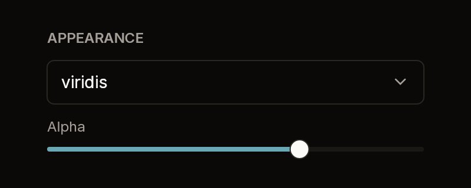

# Section

A small, bold caption above whatever you build into it, in a column as wide as
its parent. It takes nothing: it only groups.



Fixture: `section-default`: a caption, a closed [Select](select.md) and a
[Slider](slider.md).

## Build

```cs
public static Box Build(BibuiRuntime runtime, ReadOnlySpan<char> caption)

public const float Spacing = 12f;   // under the caption, and between children
```

It returns the column with the caption already in it. Push the column to build
the section's children, and put `runtime.Gap(Section.Spacing)` between them.

## Claims and reports

None. It returns a `Box`.

## State the caller owns

None.

## Theme tokens

- Caption: `TextColor.Secondary`, bold, at the small size.

## Example

```csharp
using Bibui.Core;
using Bibui.Core.Runtime;

sealed class AppearanceSection
{
    const string Caption = "APPEARANCE";
    const string Dark = "Dark mode";
    const string Alpha = "Alpha";

    bool _dark = true;     // the caller's state
    float _alpha = 0.67f;

    public UiNode Build(BibuiRuntime runtime)
    {
        Box column = runtime.Box();
        column.ChildLayoutAxis = LayoutAxis.Y;
        column.SizeX = SemanticSize.Pixels(320f);
        column.SizeY = SemanticSize.ChildrenSum();
        using (runtime.PushParent(column))
        using (runtime.PushParent(Section.Build(runtime, Caption)))
        {
            if (runtime.Switch("appearance-dark", _dark, Dark).Clicked) _dark = !_dark;
            runtime.Gap(Section.Spacing);
            _alpha = runtime.Slider("appearance-alpha", _alpha, 0f, 1f, 0.01f, Alpha).Value;
        }
        return column;
    }
}
```
