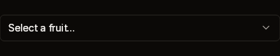
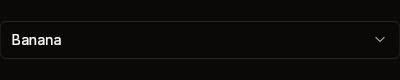
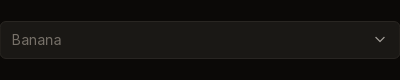
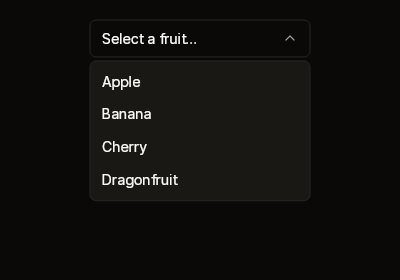
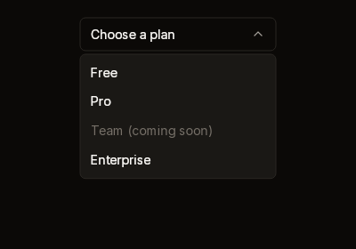
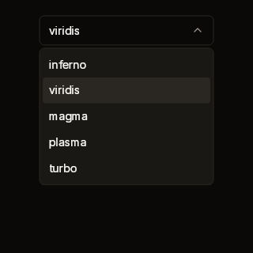

# Select

A trigger showing the current choice and a chevron. When open, it shows a
raised list under the trigger. You build the list's rows between `Begin` and
`End`, either with `runtime.SelectItem` or with rows of your own.

| Closed | With a value | Disabled |
|---|---|---|
|  |  |  |

| Open | A disabled option | Open with a selected row |
|---|---|---|
|  |  |  |

Fixtures: `select-default`, `select-with-value`, `select-disabled`,
`select-open`, `select-disabled-option` and `select-colormap`.

## Begin, Item, End

```cs
public static SelectScope Begin(
    BibuiRuntime runtime,
    string id,
    ReadOnlySpan<char> text,
    float width = 220f,
    bool disabled = false)

public static BibuiWidget SelectItem(
    this BibuiRuntime runtime,
    string id,
    ReadOnlySpan<char> label,
    bool selected = false,
    bool disabled = false)

// SelectScope
public bool Open { get; }
public void Close();
public Box End();
```

| Parameter | Meaning |
|---|---|
| `id` | The trigger's retained box. The list is the dropdown `{id}-list`. |
| `text` | What the trigger reads: the chosen option's label, or a placeholder. |
| `width` | The trigger's width. The list is as wide as the trigger was drawn. |
| `disabled` | A raised, quiet trigger that swallows the press. It never opens. |
| `Item.selected` | Draws that row raised. |
| `Item.disabled` | A quiet row that swallows the press. |

Build rows only while `scope.Open` is true. Then call `End()` exactly once, even
when the select is closed.

## Claims and reports

- The trigger claims `InteractionKinds.LeftPress`, or `Disabled`. Each `Item`
  row claims `LeftPress`, or `Disabled`, and returns its own `BibuiWidget`.
- The list is one of the runtime's dropdowns. It is drawn over everything, and
  nothing beneath it gets a press where it was drawn. After its rows, it claims
  `InteractionKinds.Press`, so a press on its padding stops there.
- A click on the trigger opens the list, or closes it. A press that a box
  outside the select takes closes it too, and so does one nothing takes.
- `End()` returns the trigger, to place.

## State the caller owns

Which value is chosen. The runtime keeps whether the list is open: call
`Close()` when you apply an item's click.

## Theme tokens

- Trigger: a `Surface` fill (`SurfaceRaised` when disabled) and a `Border` edge.
  The chevron is `TextSecondary`. The text is `TextColor.Primary`, or
  `TextColor.Disabled`.
- List: a `SurfaceRaised` fill, a `Border` edge and the
  `runtime.Theme.Elevation` overlay shadow.
- Rows: `SurfaceRaisedHover` when selected and under the pointer.
  `TextColor.Primary`, or `TextColor.Disabled`.
- Edges are `runtime.Theme.Borders.Width` wide. Vertical padding is scaled by
  `runtime.Theme.Density`.

## Example

```csharp
using Bibui.Core;
using Bibui.Core.Runtime;

sealed class FruitPicker
{
    const string Placeholder = "Select a fruit…";
    static readonly (string Label, string Value)[] Fruits =
    [
        ("Apple", "apple"),
        ("Banana", "banana"),
        ("Cherry", "cherry"),
    ];

    string? _fruit;        // the caller's state

    public UiNode Build(BibuiRuntime runtime)
    {
        string shown = Placeholder;
        foreach (var (label, value) in Fruits)
            if (value == _fruit) shown = label;

        var select = Select.Begin(runtime, "fruit", shown);
        if (select.Open)
            foreach (var (label, value) in Fruits)
                if (runtime.SelectItem("fruit-" + value, label, selected: value == _fruit).Clicked)
                {
                    _fruit = value;
                    select.Close();
                }
        return select.End();
    }
}
```
