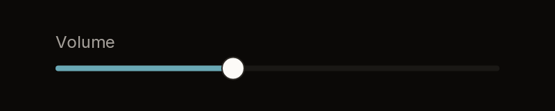
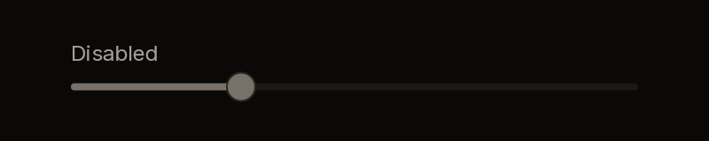

# Slider

A value on a track: a groove, the filled share up to the value, and a round
thumb centred on it, with an optional label above. Press anywhere on the track
or drag it, and the slider reports the value under the pointer, snapped to the
step.

| Default | Disabled |
|---|---|
|  |  |

Fixtures: `slider-default` and `slider-disabled-true`. `section-default` shows one in a
[Section](section.md).

## Build

```cs
public static SliderWidget Build(
    BibuiRuntime runtime,
    string id,
    float value,
    float min = 0f,
    float max = 1f,
    float step = 0f,
    ReadOnlySpan<char> label = default,
    bool disabled = false)

public readonly record struct SliderWidget(UiNode Node, float Value, Interaction Interaction);
```

| Parameter | Meaning |
|---|---|
| `id` | The track's retained box. |
| `value` | The value to draw. |
| `min`, `max` | The range. |
| `step` | Snaps the value under the pointer. 0 is continuous. |
| `label` | A small secondary caption above the track. |
| `disabled` | Draws the fill and thumb in the disabled colour. Swallows the press. |

It is as wide as its parent unless you size `Node`. The track is 16 px tall.

## Claims and reports

- The track claims `InteractionKinds.LeftPress`, or `Disabled`.
- It returns a `SliderWidget`. While the track is pressed or dragged, `Value` is
  the value under the pointer. At other times it is the value you passed, so you
  can assign `Value` every frame and nothing changes until it is touched. If
  every intermediate value is expensive, wait for `Interaction.Released`.

## State the caller owns

The `value`.

## Theme tokens

- Groove: `SurfaceRaised`. Fill: `Accent`, or `TextDisabled`.
- Thumb: `TextPrimary` (or `TextDisabled`) with a `Border` edge
  `runtime.Theme.Borders.Width` wide.
- Label: `TextColor.Secondary`, at the small size.

## Example

```csharp
using Bibui;
using Bibui.Runtime;

sealed class VolumeControl
{
    const string Label = "Volume";

    float _volume = 40f;   // the caller's state

    public UiNode Build(BibuiRuntime runtime)
    {
        var slider = Slider.Build(runtime, "volume", _volume, min: 0f, max: 100f, step: 1f, label: Label);
        _volume = slider.Value;   // unchanged unless the track is being pressed or dragged
        return slider.Node.Px(width: 320f);   // otherwise as wide as its parent
    }
}
```
