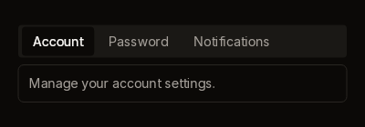
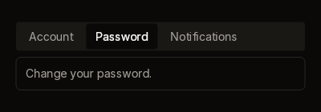

# Tabs

A strip of tab headers on a raised track, with the active tab cut out of it in
the background colour. The panel underneath is a separate call, so you decide
what goes in it.

| Account | Password |
|---|---|
|  |  |

Fixtures: `tabs-account` and `tabs-password`.

## Build and Panel

```cs
public static TabsWidget Build(
    BibuiRuntime runtime,
    string id,
    IReadOnlyList<TabOption> items,
    string? value)

public static Box Panel(BibuiRuntime runtime);

public const float Height = 36f;     // the strip, at the default density
public const float PanelGap = 8f;    // the space to put between strip and panel

public readonly record struct TabOption(BibuiStr Label, string Value);
public readonly record struct TabsWidget(Box Node, string? Picked);
```

| Parameter | Meaning |
|---|---|
| `id` | Names the tabs: `{id}-{value}`. |
| `items` | The tabs in order. |
| `value` | The active tab's value. |

The strip is as wide as its parent. `Panel` returns a bordered, padded column as
wide as its parent and as tall as its content. Push it and build the active
tab's content into it.

## Claims and reports

- Each tab claims `InteractionKinds.LeftPress`.
- `Build` returns a `TabsWidget`. `Picked` is the value of the tab clicked this
  frame, or null.

## State the caller owns

The active tab's `value`, and the content of each tab.

## Theme tokens

- Strip: a `SurfaceRaised` fill. Its 36 px height is scaled by
  `runtime.Theme.Density`.
- Active tab: a `Background` fill with a `TextColor.Primary` label. The other
  tabs have `TextColor.Secondary` labels and a `SurfaceRaisedHover` hover fill.
- Panel: a `Surface` fill and a `Border` edge, `runtime.Theme.Borders.Width` wide.

## Example

```csharp
using Bibui;
using Bibui.Runtime;

sealed class SettingsTabs
{
    static readonly TabOption[] Items =
    [
        new(BibuiStr.FromStrLit("Account"u8), "account"),
        new(BibuiStr.FromStrLit("Password"u8), "password"),
    ];
    static readonly byte[] AccountText = "Manage your account settings."u8.ToArray();
    static readonly byte[] PasswordText = "Change your password."u8.ToArray();

    string _tab = "account";   // the caller's state

    public UiNode Build(BibuiRuntime runtime)
    {
        Box column = runtime.Box();
        column.ChildLayoutAxis = LayoutAxis.Y;
        column.SizeX = SemanticSize.Pixels(360f);
        column.SizeY = SemanticSize.ChildrenSum();
        using (runtime.PushParent(column))
        {
            var tabs = Tabs.Build(runtime, "settings-tabs", Items, _tab);
            if (tabs.Picked is { } picked) _tab = picked;
            runtime.Gap(Tabs.PanelGap);
            using (runtime.PushParent(Tabs.Panel(runtime)))
                runtime.Text(_tab == "account" ? AccountText : PasswordText, textColor: TextColor.Secondary);
        }
        return column;
    }
}
```
