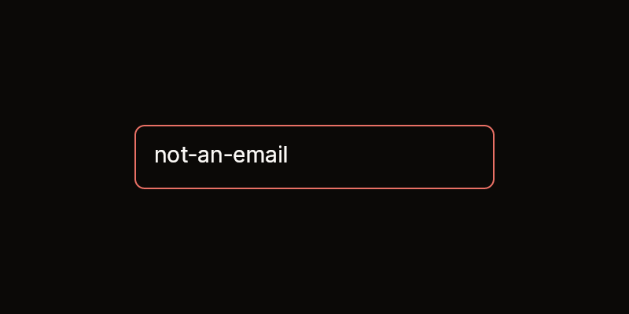
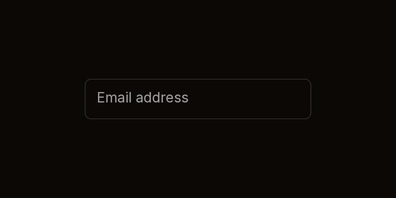
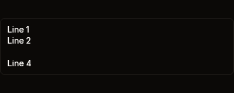
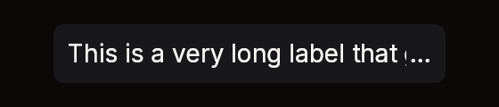
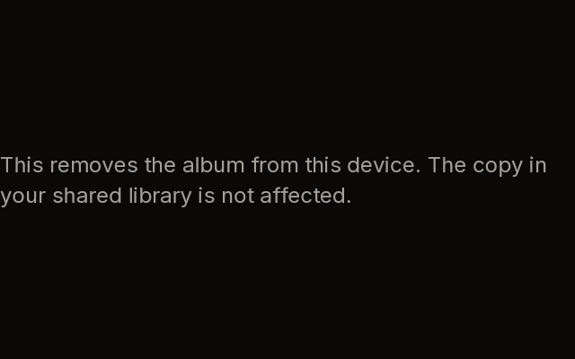

# TextField

Text you can show, select and edit, drawn from your own buffer (`BibuiStr`) and
edit state (`TextEditState`). There are three kinds of field and one look:

- `SingleLine`: one line, clipped at the box's edge, that scrolls to keep the
  caret in view.
- `Ellipsis`: one line that ends in "…" when it does not fit.
- `Multiline`: text wrapped at the box's width. The wheel scrolls it.
- `InputStyle`: the padded, outlined input look, applied to a box you hold.

A field draws no frame of its own. It fills the box you pushed. For an input,
acquire a box, give it `InputStyle` and a size, push it, and build the field
inside.

| Input | Error | Disabled |
|---|---|---|
|  |  |  |

| Placeholder | Textarea | Ellipsis |
|---|---|---|
|  |  |  |



Fixtures: `input-filled`,
`input-no-error`, `input-error`, `input-disabled`, `input-focused`,
`textarea-default`, `textarea-no-error`, `textarea-error`, `textarea-disabled`,
`textarea-multiline`, `text-ellipsis` and `text-ellipsis-fits`. The wrapped
paragraphs are `text-wrap-default`, `text-wrapped-autosize-mid` and
`text-wrapped-autosize-cap`. No fixture draws a
focused field with its caret yet: `input-focused` is an unfocused, empty field
showing its placeholder.

## SingleLine, Ellipsis, Multiline

```cs
public static BibuiWidget SingleLine(
    BibuiRuntime runtime, string id, BibuiStr text, TextEditState edit, bool focused,
    uint events = SingleLineEvents,
    TextColor textColor = TextColor.Primary,
    BibuiStr? placeholder = null)

public static BibuiWidget Ellipsis(
    BibuiRuntime runtime, string id, BibuiStr text, TextEditState edit, bool focused,
    uint events = 0,
    TextColor textColor = TextColor.Primary,
    BibuiStr? placeholder = null)

public static BibuiWidget Multiline(
    BibuiRuntime runtime, string id, BibuiStr text, TextEditState edit, bool focused,
    uint events = MultiLineEvents,
    TextColor textColor = TextColor.Primary,
    BibuiStr? placeholder = null,
    TextWrap wrap = TextWrap.Words)

public static SemanticSize Rows(BibuiRuntime runtime, int rows);
public static void InputStyle(BibuiRuntime runtime, Box box, bool focused, bool error = false, bool disabled = false);

public const uint SingleLineEvents, SingleLineReadOnlyEvents;
public const uint MultiLineEvents, MultiLineReadOnlyEvents;
```

| Parameter | Meaning |
|---|---|
| `id` | The field's retained view box, inside the box you pushed. |
| `text` | Your buffer. A focused field edits it in place. |
| `edit` | Your caret (`Cursor`) and selection anchor (`Mark`), as byte offsets. A press or drag moves them. |
| `focused` | Shows the caret and selection, and applies the frame's text events. |
| `events` | Which events a focused field takes, as bits of `BibUiEventKind`. `SingleLineEvents` edits, `SingleLineReadOnlyEvents` selects and copies, and 0 only shows the text and takes no press. `MultiLineEvents` also takes `Submit` (Enter) as a new line. |
| `textColor` | The text's colour. A placeholder is always `TextColor.Secondary`. |
| `placeholder` | Shown, quieter, while the buffer is empty. |
| `wrap` | `Multiline` breaks between words, or anywhere. |

Sizes: `SingleLine` is one line tall and as wide as its parent. `Ellipsis` needs
a parent that is not sized by its children, because it measures the width that
parent had last frame. `Multiline` is as tall as the size pushed with
`runtime.PushSizeY`: `SemanticSize.ChildrenSum()` to fit its lines,
`TextField.Rows(runtime, n)` for `n` lines, or a share.

`InputStyle(runtime, box, focused, error, disabled)` pads and outlines a box you
hold. It uses the focus ring while focused, the destructive colour on an error,
and the raised surface when disabled. It claims nothing, so a disabled input
should also acquire its frame with `InteractionKinds.Disabled`, as the
`input-disabled` fixture does.

## Claims and reports

- The view box claims `InteractionKinds.Clip` with `ClampX` (single line) or
  `ViewScrollY | ClampY` (multi-line), and adds `LeftPress` when `events` is not
  0.
- It returns a `BibuiWidget` whose `Node` is the view. `Pressed` is your cue to
  focus the field. A press or drag places the caret and selects. A double press
  selects a word.
- While focused, it eats the frame's events of the kinds in `events`. Copy and
  cut go to the clipboard through `runtime.ClipboardSet`.

## State the caller owns

The text (`BibuiStr`), the caret and selection (`TextEditState`), and whether the
field is focused. The field never changes focus: set it on `Pressed`, and clear
it yourself on Escape, on Submit, or on a press elsewhere.

## Theme tokens

- `InputStyle`: a `Surface` fill (`SurfaceRaised` when disabled), a `Border`
  edge, a `Destructive` edge on error, and `runtime.Theme.FocusRing` (colour and
  width) while focused. The edge is `runtime.Theme.Borders.Width` wide, and the
  vertical padding is scaled by `runtime.Theme.Density`.
- Field: the text is `textColor`, the placeholder is `TextColor.Secondary`, and
  the caret is `TextPrimary`, gliding at `runtime.Theme.Motion.Caret`. The
  selection highlight is a fixed translucent blue, not a token yet.

## Example

```csharp
using Bibui;
using Bibui.Runtime;
using Bibui.TextEdit;

sealed class EmailInput
{
    static readonly BibuiStr Placeholder = BibuiStr.FromStrLit("Email address"u8);

    readonly BibuiStr _email = new(64);              // the caller's state
    readonly TextEditState _edit = new();
    bool _focused;

    public UiNode Build(BibuiRuntime runtime)
    {
        // The frame: the input look around one line, 240 px wide.
        Box frame = runtime.Box();
        TextField.InputStyle(runtime, frame, _focused);
        frame.SizeX = SemanticSize.Pixels(240f);
        frame.SizeY = SemanticSize.ChildrenSum();

        BibuiWidget line;
        using (runtime.PushParent(frame))
            line = TextField.SingleLine(runtime, "email", _email, _edit, _focused, placeholder: Placeholder);
        if (line.Pressed) _focused = true;

        // Escape or Enter ends editing.
        foreach (var handle in runtime.UnconsumedEvents)
            if (_focused && handle.Event is { Kind: BibUiEventKind.Press, Key: Key.Escape } or { Kind: BibUiEventKind.Submit })
            {
                _focused = false;
                handle.Eat();
            }
        return frame;
    }
}
```

A textarea is the same, with `Multiline` and a height pushed for it:

```csharp
using Bibui;
using Bibui.Runtime;
using Bibui.TextEdit;

sealed class MessageBox
{
    static readonly BibuiStr Placeholder = BibuiStr.FromStrLit("Type your message here."u8);

    readonly BibuiStr _message = new(256);           // the caller's state
    readonly TextEditState _edit = new();
    bool _focused;

    public UiNode Build(BibuiRuntime runtime)
    {
        Box frame = runtime.Box();
        TextField.InputStyle(runtime, frame, _focused);
        frame.SizeX = SemanticSize.Pixels(400f);
        frame.SizeY = SemanticSize.ChildrenSum();

        using (runtime.PushParent(frame))
        using (runtime.PushSizeY(TextField.Rows(runtime, 3)))
            if (TextField.Multiline(runtime, "message", _message, _edit, _focused, placeholder: Placeholder).Pressed)
                _focused = true;
        return frame;
    }
}
```
