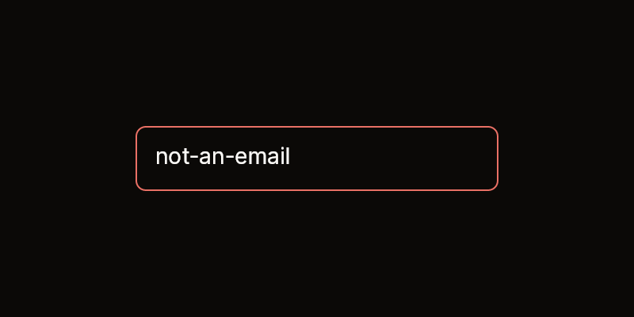
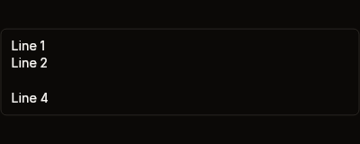
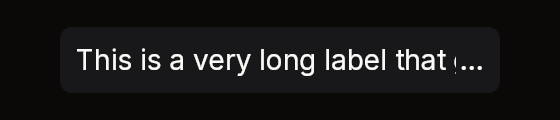
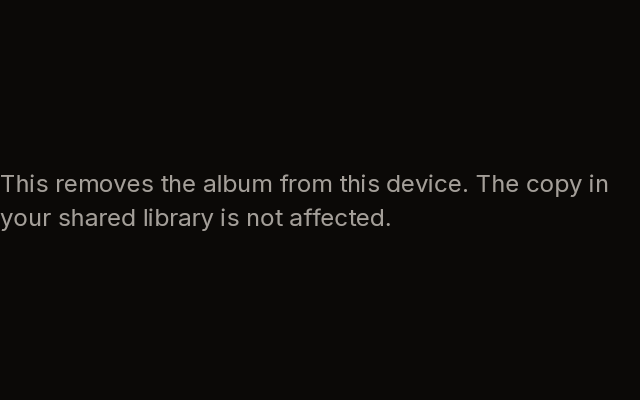

# TextField

Text you can show, select and edit, drawn from your own buffer (`BibuiStr`) and
edit state (`TextEditState`). There are three kinds of field and one look:

- `SingleLine`: one line, clipped at the box's edge, that scrolls to keep the
  caret in view.
- `Ellipsis`: one line that ends in "…" when it does not fit.
- `Multiline`: text wrapped at the box's width. The wheel scrolls it.
- `InputStyle`: the padded, outlined input look, applied to a box you hold.

A field draws no frame of its own. It fills the parent in scope. For an input,
acquire a box, give it `InputStyle` and a size, begin it as the parent
(`BeginParent`), and build the field inside.

| Input | Error | Disabled |
|---|---|---|
|  |  |  |

| Focused, with a selection | Placeholder | Textarea | Ellipsis |
|---|---|---|---|
|  |  |  |  |



Fixtures: `input-filled`,
`input-no-error`, `input-error`, `input-disabled`, `input-focused`, `input-placeholder`,
`textarea-default`, `textarea-no-error`, `textarea-error`, `textarea-disabled`,
`textarea-multiline`, `text-ellipsis` and `text-ellipsis-fits`. The wrapped
paragraphs are `text-wrap-default`, `text-wrapped-autosize-mid` and
`text-wrapped-autosize-cap`. `input-focused` is focused, with
"example" selected and the caret at its end; `input-placeholder` is an
unfocused, empty field showing its placeholder.

## SingleLine, Ellipsis, Multiline

```cs
public static BibuiWidget TextField(
    this BibuiRuntime runtime, string id, BibuiStr text, TextEditState edit,
    uint events = SingleLineEvents,
    TextColor textColor = TextColor.Primary,
    ReadOnlySpan<char> placeholder = default)

public static BibuiWidget EllipsisTextField(
    this BibuiRuntime runtime, string id, BibuiStr text, TextEditState edit,
    uint events = 0,
    TextColor textColor = TextColor.Primary,
    ReadOnlySpan<char> placeholder = default)

public static BibuiWidget MultilineTextField(
    this BibuiRuntime runtime, string id, BibuiStr text, TextEditState edit,
    uint events = MultiLineEvents,
    TextColor textColor = TextColor.Primary,
    ReadOnlySpan<char> placeholder = default,
    TextWrap wrap = TextWrap.Words)

public static SemanticSize Rows(BibuiRuntime runtime, int rows);
public static void InputStyle(BibuiRuntime runtime, Box box, bool focused, bool error = false, bool disabled = false);

public const uint SingleLineEvents, SingleLineReadOnlyEvents;
public const uint MultiLineEvents, MultiLineReadOnlyEvents;
```

| Parameter | Meaning |
|---|---|
| `id` | The field's retained view box, inside the parent in scope. |
| `text` | Your buffer. The field edits it in place while it has focus. |
| `edit` | Your caret (`Cursor`) and selection anchor (`Mark`), as char offsets (UTF-16 code units), always on a character's boundary. A press or drag moves them. |
| `events` | Which events the field takes while it has focus, as bits of `BibUiEventKind`. `SingleLineEvents` edits, `SingleLineReadOnlyEvents` selects and copies, and 0 only shows the text, takes no press and never has focus. `MultiLineEvents` also takes `Submit` (Enter) as a new line. |
| `textColor` | The text's colour. A placeholder is always `TextColor.Secondary`. |
| `placeholder` | Shown, quieter, while the buffer is empty. |
| `wrap` | `Multiline` breaks between words, or anywhere. `TextWrap` is in `Bibui.Text`. |

Sizes: `SingleLine` is one line tall and as wide as its parent. `Ellipsis` needs
a parent that is not sized by its children, because it measures the width that
parent had last frame. `Multiline` is as tall as the size begun with
`runtime.BeginSizeY`: `SemanticSize.ChildrenSum()` to fit its lines,
`TextField.Rows(runtime, n)` for `n` lines, or a share.

`InputStyle(runtime, box, focused, error, disabled)` pads and outlines a box you
hold, built before the field, so pass `runtime.IsFocused(id)`. It uses the focus
ring while focused, the destructive colour on an error,
and the raised surface when disabled. It claims nothing, so a disabled input
should also acquire its frame with `InteractionKinds.Disabled`, as the
`input-disabled` fixture does.

## Claims and reports

- The view box claims `InteractionKinds.Clip` with `ClampX` (single line) or
  `ViewScrollY | ClampY` (multi-line), and adds `LeftPress` and `Keyboard` when
  `events` is not 0.
- It returns a `BibuiWidget` whose `Node` is the view. A press or drag places the
  caret and selects; a double press selects a word.
- Focus is the runtime's. A press on the field gives it focus from the next
  frame (`Interaction.Focused`, and `FocusGained` in the first of them). It keeps
  focus while it is built and no press lands elsewhere; a press on another field
  moves it there. `runtime.Focus(id)` gives it focus from code.
- While it has focus, it eats the frame's events of the kinds in `events`. Copy
  and cut go to the clipboard through `runtime.ClipboardSet`.
- Escape ends the edit: `Interaction.Cancelled`, and the field gives up focus.
  On a single line that edits, Enter does too, as `Interaction.Submitted`. A
  multi-line field takes Enter as a line break.
- Up and Down move a line; in a multi-line field, Page Up and Page Down move
  a page: the lines the field shows less one, with the view moving as far, so
  the caret keeps its place on screen. A page is the field's own height, so a
  field sized to fit its text (`ChildrenSum()`) pages to its start or end.
  Each keeps the caret's column as near as the line allows, and Shift
  selects. On the first line or the last they go to the start or the end of
  the text; in a single line, Up and Down always do. They are `Navigate`
  events, so a read-only field takes them too. A single-line field leaves
  Page Up and Page Down to the app, and every field does with Ctrl or Alt
  held.

## State the caller owns

The text (`BibuiStr`) and the caret and selection (`TextEditState`). Focus is the
runtime's: read it from the result, or with `runtime.IsFocused(id)` before the
field is built. A field without focus keeps its selection in sight, dimmer,
and shows no caret.

## Theme tokens

- `InputStyle`: a `Surface` fill (`SurfaceRaised` when disabled), a `Border`
  edge, a `Destructive` edge on error, and `runtime.Theme.FocusRing` (colour and
  width) while focused. The edge is `runtime.Theme.Borders.Width` wide, and the
  vertical padding is scaled by `runtime.Theme.Density`.
- Field: the text is `textColor`, the placeholder is `TextColor.Secondary`, and
  the caret is `TextPrimary`, gliding at `runtime.Rates.Follow`. The
  selection highlight is a fixed translucent blue, not a token yet; without
  focus it is the same blue at half the alpha.

## Example

```csharp
using Bibui.Core;
using Bibui.Core.Runtime;
using Bibui.Core.TextEdit;

sealed class EmailInput
{
    const string Placeholder = "Email address";

    readonly BibuiStr _email = new(64);              // the caller's state
    readonly TextEditState _edit = new();
    public string? Sent;

    public UiNode Build(BibuiRuntime runtime)
    {
        // The frame: the input look around one line, 240 px wide.
        Box frame = runtime.Box();
        TextField.InputStyle(runtime, frame, runtime.IsFocused("email"));
        frame.SizeX = SemanticSize.Pixels(240f);
        frame.SizeY = SemanticSize.ChildrenSum();

        runtime.BeginParent(frame);
        BibuiWidget line = runtime.TextField("email", _email, _edit, placeholder: Placeholder);
        runtime.EndParent(frame);

        // A press focuses it; Enter submits it, Escape abandons it, each ending the edit.
        if (line.Interaction.Submitted) Sent = _email.ToString();
        return frame;
    }
}
```

A textarea is the same, with `Multiline` and a height begun for it:

```csharp
using Bibui.Core;
using Bibui.Core.Runtime;
using Bibui.Core.TextEdit;

sealed class MessageBox
{
    const string Placeholder = "Type your message here.";

    readonly BibuiStr _message = new(256);           // the caller's state
    readonly TextEditState _edit = new();

    public UiNode Build(BibuiRuntime runtime)
    {
        Box frame = runtime.Box();
        TextField.InputStyle(runtime, frame, runtime.IsFocused("message"));
        frame.SizeX = SemanticSize.Pixels(400f);
        frame.SizeY = SemanticSize.ChildrenSum();

        runtime.BeginParent(frame);
        runtime.BeginSizeY(TextField.Rows(runtime, 3));
        runtime.MultilineTextField("message", _message, _edit, placeholder: Placeholder);
        runtime.EndSizeY();
        runtime.EndParent(frame);
        return frame;
    }
}
```
