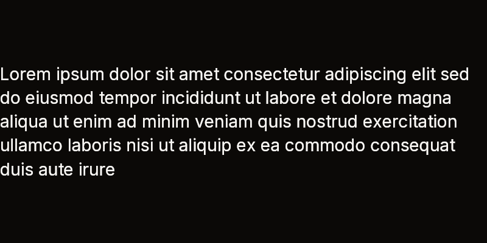

# Text, Icon and Spinner

These three are the runtime's own leaves, not component classes. They are
methods on `BibuiRuntime` that every component builds from. Each one links a
node under the parent in scope and returns it, so you can change it before the
frame is laid out.

| Text | Bold, large, accent | Wrapped (see [TextField](text-field.md)) |
|---|---|---|
|  |  |  |

| Icon | Icon, secondary | Spinner |
|---|---|---|
|  |  |  |

Fixtures: `text-label`, `text-align-right`, `text-centered-accent`,
`text-color-disabled`, `text-size-xl`, `text-size-xxl`, `text-tracked-eyebrow`,
`text-wrapped-autosize-short`, `label-default`, the `icon-*` fixtures and
`spinner-default`. [Fixtures by component](fixtures.md) lists them all.

## Text

```cs
public Text Text(ReadOnlySpan<char> text, FontSize? fontSize = null, UiColor? textColor = null, FontSlot? family = null)
public Text TextFromId(string id, ReadOnlySpan<char> text, FontSize? fontSize = null, UiColor? textColor = null, FontSlot? family = null)

public void BeginFontSize(FontSize size)
public void EndFontSize()
public void BeginFontFace(FontSlot? family = null, FontWeight? weight = null)
public void EndFontFace()
```

`PushFontSize` and `PushFontFace` are the same Begins, handing back a scope
whose `Dispose` is the End.

- `text` is copied into the node, so a `string`, a slice of a `BibuiStr` or
  text formatted into a stack buffer will all do, and may change as soon as the
  call returns.
- `fontSize` is a `ComponentSize` step (`Sm`, `Md`, `Lg`, `Xl`, `Xxl`) or
  `FontSize.Px(n)`. Without one, the text uses the size begun with
  `BeginFontSize`, or `Md`.
- `textColor` is a token (`UiColor.TextSecondary`, or a `TextColor` such as
  `TextColor.Secondary`). Without one, it is `TextPrimary`.
- The weight comes from `BeginFontFace(weight: FontWeight.Bold)`. The family
  comes from `family`, or the one begun, or the body family.
- A text is as large as what it holds, unless a size is begun with
  `BeginSizeX` or `BeginSizeY`. One line, no wrapping: for wrapped text use
  `runtime.MultilineTextField` with `events: 0`.
- `Text` is keyless and pooled. Use `TextFromId` when the text must be found
  again, by a test or an animation.

## Icon

```cs
public Icon Icon(string name, float? size = null)
```

- `name` is a Lucide-style glyph name, such as `"search"`, `"check"` or
  `"chevron-down"`, or the name of an icon the app registered (below). Names
  ignore case. An unknown name throws in a debug build and draws its first
  letter in a release build; check a name that comes from data with
  `Icon.IsKnown`.
- `size` is the side in pixels. Without one, the icon uses the font size in
  scope, so an icon beside a label matches the label.
- Set `Color` on the returned `Icon`. Without it, the icon is `TextPrimary`.

### Icons of the app's own

```cs
public static void Icons.Register(string name, string svgPathData)
public static bool Icons.IsBuiltIn(string? name)
public static IReadOnlyList<string> Icons.Names
```

An app that needs an icon bibui does not have registers it once, at start-up,
before the first frame:

```csharp
Icons.Register("moon", "M12 3a6 6 0 009 9 9 9 0 11-9-9z");   // Lucide, ISC
// ...
runtime.Icon("moon", 16f);
```

- `svgPathData` is the `d` attribute of an SVG path, drawn by the same rules
  as the built-in set: a **24×24 viewBox**, **stroked 2 units wide** with
  **round caps and joins**, never filled, scaled to the icon's size. Draw it
  for that grid; Lucide's and Feather's icons already are.
- An icon of several elements is one path: join their path data, starting each
  part with an absolute `M` (a lone element's leading `m` is relative to the
  origin), and write a `<circle cx cy r>` as two arcs,
  `M{cx+r} {cy}a{r} {r} 0 1 1-{2r} 0 {r} {r} 0 0 1 {2r} 0z`. Commands M L H V C
  S Q T A Z are supported, absolute and relative.
- The path is checked when it is registered, so bad data fails at start-up,
  not when a frame is painted: a parse error, a path that does not begin with
  a move, a number that is not finite, or a path with nothing to stroke throws
  `FormatException`, naming the icon.
- A built-in name throws `ArgumentException`: an app icon cannot replace one of
  bibui's. Registering the same name with the same path again does nothing,
  so a start-up routine may run twice; with other path data it throws, since
  two parts of the app disagree about what the name draws.
- Registration is plain strings: no discovery, no reflection, safe under Native
  AOT. It is meant to finish before the first frame; reads while it happens
  are safe, but there is no unregistering.
- `Icon.IsKnown` and the fixture verifier's unknown-icon check see registered
  icons. `Icons.Names` lists every name, built-in then registered, for a
  gallery or a picker.
- Ship the icon's licence with the app. The showcase's `AppIcons.cs` registers
  five Lucide icons and credits them in `NOTICE`.

## Spinner

```cs
public Spinner Spinner(float diameter = 24f)
```

- A ring that turns by itself: it asks for the next frame, so it needs no clock
  from you.
- The arc is `TextPrimary` and the track ring is `Border`, unless you set
  `Color` or `TrackColor` on the returned `Spinner`.

## Claims and reports

None of the three claims or reports anything.

## Example

```csharp
using Bibui.Core;
using Bibui.Core.Runtime;

sealed class SearchStatus
{
    const string Heading = "OVERVIEW";
    const string Searching = "Searching…";

    public bool Busy { get; set; }   // the caller's state, shown

    public UiNode Build(BibuiRuntime runtime)
    {
        var column = runtime.BeginParent(runtime.Column());
        runtime.BeginFontFace(weight: FontWeight.Bold);
        runtime.Text(Heading, ComponentSize.Sm, TextColor.Secondary);
        runtime.EndFontFace();
        runtime.Gap(8f);

        var row = runtime.BeginParent(runtime.Row());
        if (Busy) runtime.Spinner(16f);
        else runtime.Icon("search", 16f).Color = UiColor.Accent;
        runtime.Gap(8f);
        runtime.Text(Searching, ComponentSize.Sm);
        runtime.EndParent(row);
        runtime.EndParent(column);
        return column;
    }
}
```
