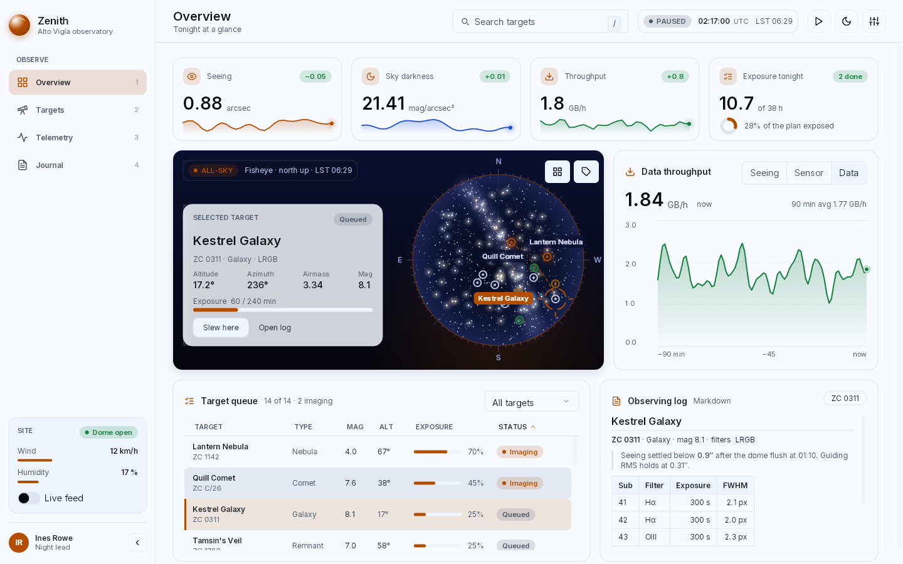
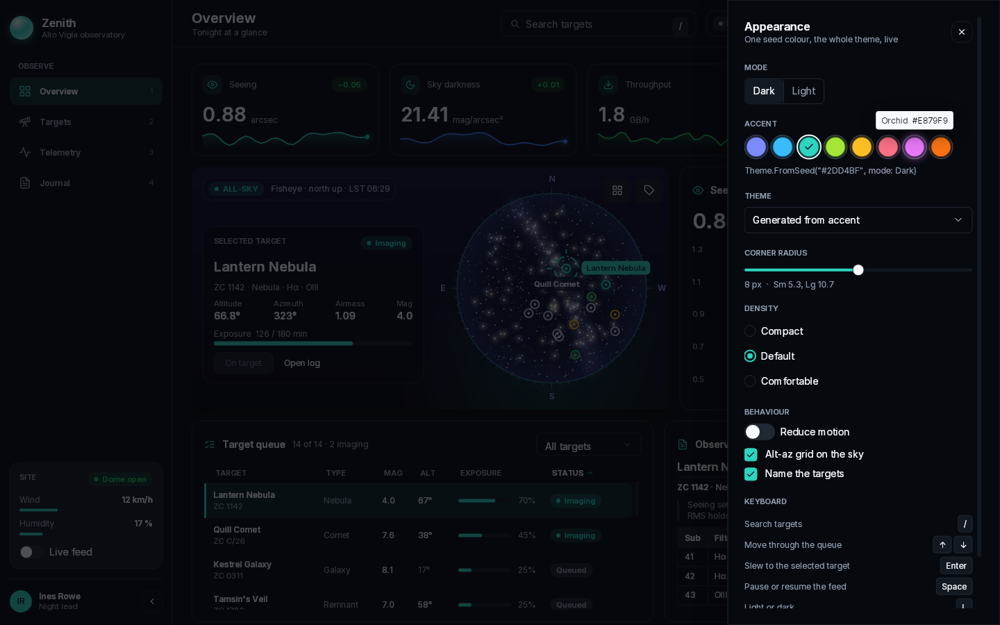
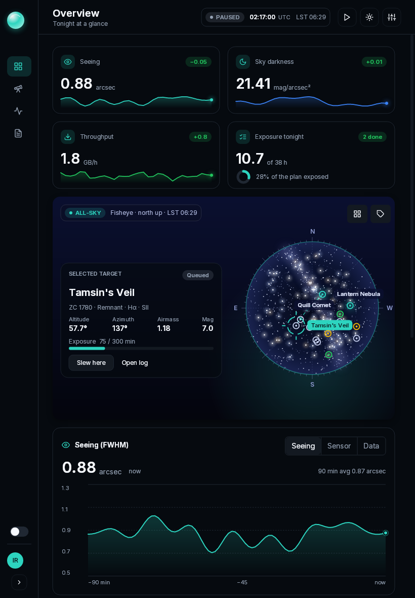

# Zenith: an observatory console

The showcase of what bibui can do. Zenith runs the night at an invented
observatory: a live all-sky view of the dome, telemetry charts, the target
queue, and the observing log, in one native window. Everything in it (the site,
the targets, the numbers) is made up.


| Light, from another seed colour | One seed, the whole theme |
|---|---|
|  |  |



## Run it

Two setups, one app:

```bash
# Cross-platform: GLFW window, OpenGL when it can, Skia raster
dotnet run --project samples/showcase -c Release

# Linux, pure managed: raw Wayland, managed raster with FreeType/HarfBuzz text
dotnet run --project samples/showcase -c Release -- --host wayland --raster managed
```

The Wayland + managed route publishes as one Native AOT executable, with Silk
and Skia left out of it:

```bash
dotnet publish samples/showcase -c Release -r linux-x64 \
  -p:PublishAot=true -p:ShowcaseRoute=wayland -o out/showcase
out/showcase/showcase
```

That binary is about 5.2 MB, and reaches its first rendered 1440×900 frame
about 30 ms after it is spawned.

Without a window:

```bash
dotnet run --project samples/showcase -c Release -- --shots samples/showcase/screenshots   # these pictures
dotnet run --project samples/showcase -c Release -- --png out.png --size 1280x800 --light
dotnet run --project samples/showcase -c Release -- --selftest   # clicks and keys, checked
```

`--accent "#38BDF8"`, `--light` and `--page targets|telemetry|journal` set the
start. `--help` lists everything.

## Things to try

- **Resize the window.** Below 1080 px the sidebar folds to a rail with
  tooltips; narrower still, the cards stack and the page scrolls.
- **Open Appearance** (the sliders button, or `,`). Pick a swatch: the whole
  theme is generated from that one colour with `Theme.FromSeed`, live. Switch
  dark and light, drag the corner radius, change the density, or load one of
  the theme files in `themes/`.
- **Hover the charts** for a crosshair and a reading; hover a target on the dome
  for its tooltip; click one to select it, double-click to slew to it.
- **Right-click a row** of the queue for its menu. Click a column header to sort.
- **Keyboard:** `/` search, `↑` `↓` move through the queue, `Enter` slew,
  `Space` pause the feed, `L` light or dark, `[` fold the sidebar, `1`–`4` pages,
  `Esc` to back out.
- **Turn on Reduce motion**: the theme's easing becomes `None`, and every
  animation, the turning reticle and the pulsing chart head included, stops.

## What is where

| What it shows | Where |
|---|---|
| The dome: radial and linear gradients, a blurred galactic band, 1 500 stars, a dashed alt-az grid, a slew path, and a turning reticle, all through `DrawContext` | `Sky.cs` |
| Live charts: area gradients, a pulsing head (`DrawContext.Sawtooth`), a hover crosshair; sparklines and a ring gauge | `Charts.cs` |
| Frosted glass over the sky (`Style.BackdropBlur`), target hit boxes laid over a painted canvas, ask order as z-order | `Pages.cs`, `SkyCard` |
| The sidebar's fold, eased with `runtime.Animate`; hover with `HotT` on every row and button | `Shell.cs` |
| The queue: search, sort, filter (`Select`), selection, a context `Menu`, a scroll view with a `Scrollbar` | `Pages.cs`, `QueueCard` |
| Markdown: headings, lists, a table, a code block, task boxes that toggle, links | `Pages.cs`, `LogCard`; `Data.cs` |
| `Theme.FromSeed`, light and dark, theme files with `extends`, density, radius, reduced motion | `App.cs`, `Theme()`; `Settings.cs`; `themes/` |
| A `Dialog` sheet built in statement form, with `ToggleGroup`, `Slider`, `RadioGroup`, `Switch`, `Checkbox`, `Select`, `KeyboardShortcut`, `Tooltip` | `Settings.cs` |
| `Expander`, `Separator`, `Badge`, `Avatar`, `Progress`, a multi-line `TextField` | `Shell.cs`, `Settings.cs` (Journal) |
| State owned by the app, keyboard shortcuts, no callbacks | `App.cs` |
| Icons of the app's own (moon, sun, telescope, thermometer, activity), registered at start-up with `Icons.Register` | `AppIcons.cs`, `Program.cs` |

Each piece is a plain function that composes runtime boxes, as bibui's own
components are. The app owns all its state; the build reads it, asks the boxes
it holds what happened, and writes the answers back.

## Where bibui fell short

Each is worked around in the open where the code says so:

- **Rounded backdrop blur.** `BackdropBlur` ignores `CornerRadius`; zoom into the glass card's
  corners and the blur shows square.
- **Scrim and token groups.** The dialog scrim is a fixed near-black, heavy in light mode; token
  groups are not records, so reduced motion copies `MotionTokens` field by field.
- **Faces.** No italic face, no embedded monospace face, so code
  blocks are set in the body face.
